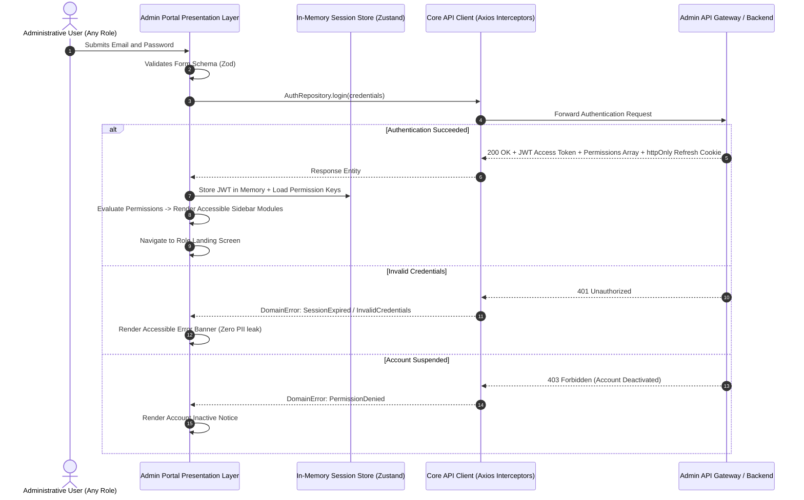
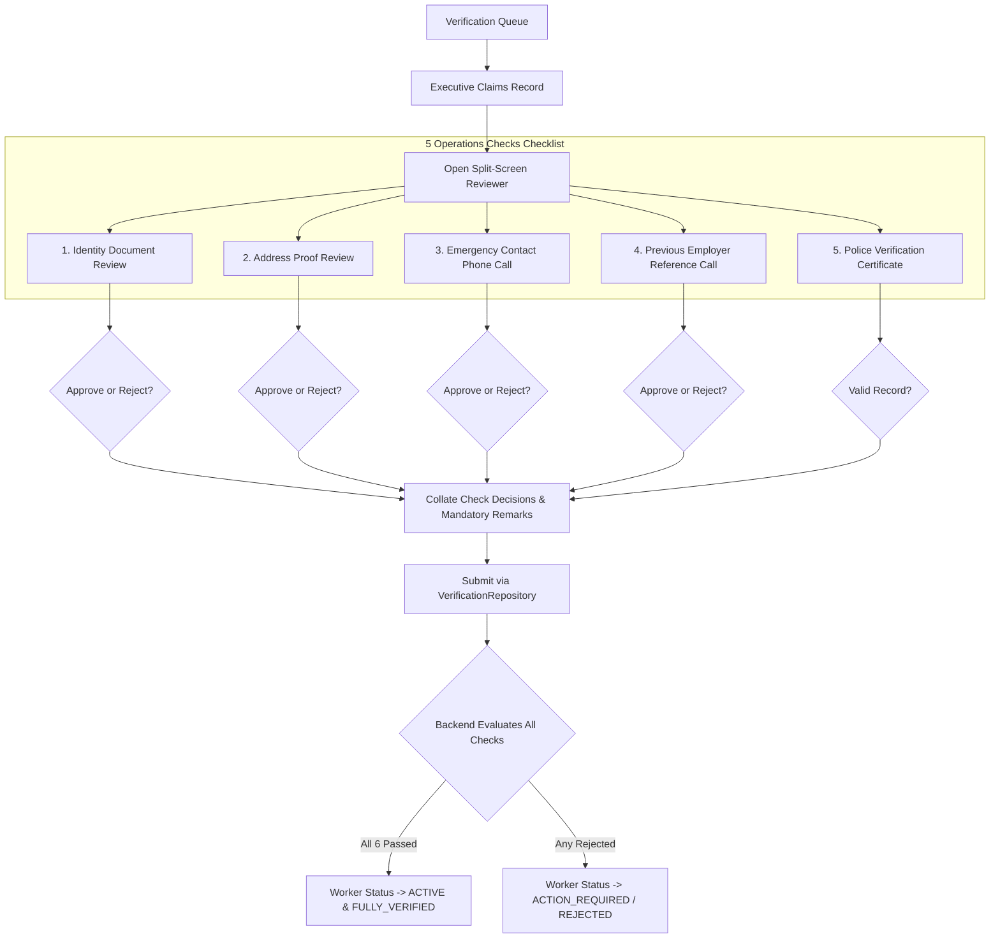
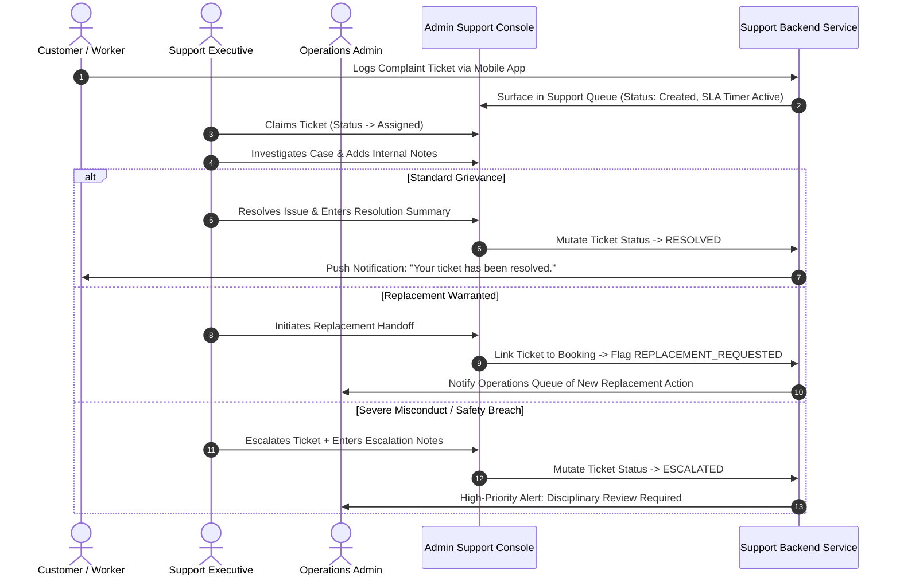

# SevaNest Admin Portal: Role-Wise Operational Workflows & Governance Specification

> **Document Version:** 1.0.0  
> **Status:** Authoritative Operational & Role-Based Access Specification  
> **Target Audience:** Operations Leadership, System Administrators, Verification Executives, Support Specialists, Security Architects, Frontend Engineers, and QA Test Engineers  
> **Source Documents:** *SevaNest Product Requirements Document (PRD)*, *SevaNest Admin Portal Frontend Architecture Document (v1.0)*, & *SevaNest Admin Portal Workflow and Frontend Development Plan*

---

## 1. Document Overview and Role Governance Framework

### 1.1 Purpose and Scope
This document defines the complete, step-by-step operational workflows, permission boundaries, sensitive data access rules, cross-role handoffs, and acceptance criteria for every administrative persona operating the **SevaNest Web Admin & Operations Portal**.

The SevaNest platform enforces a **Dual-Gated Role-Based Access Control (RBAC)** model:
1. **Frontend Presentation Gate:** The user interface dynamically evaluates granular, server-issued permission keys (e.g., `verification.review`, `refunds.manage`, `configuration.manage`) rather than static role strings. Navigation menus, action buttons, table columns, and view drawers are conditionally rendered or hidden based on these keys.
2. **Backend Enforcement Gate:** Every mutation, query, document fetch, and status transition is independently validated and authorized by backend microservices. A client-side visual control is a convenience; the server remains the ultimate source of truth.

### 1.2 Administrative Role Personas
The SevaNest platform defines four distinct administrative personas in Version 1:
- **Super Admin:** Executive platform controller responsible for platform configuration masters, pricing plans, service categories, geographic boundaries, notification templates, RBAC role-permission assignments, high-level business analytics, and authoritative audit log inspections.
- **Operations Admin:** Day-to-day operational manager overseeing the marketplace pipeline, including worker vetting oversight, customer booking triage, manual worker matching, trial scheduling, replacement arbitration, and refund approvals.
- **Verification Executive:** Dedicated Trust & Safety specialist focused exclusively on inspecting worker identification, address proofs, emergency contacts, prior employment references, and tracking police verification status.
- **Support Executive:** Frontline customer and worker service specialist responsible for triaging grievance tickets, monitoring SLA breach thresholds, arbitrating day-to-day service disputes, and facilitating replacement escalations.

### 1.3 Strict Architectural and Compliance Principles
- **Zero Hardcoded Permissions:** Roles are collections of granular permission keys. The permission matrix documented herein represents the baseline architecture; final permissions are configured and maintained dynamically by the Super Admin in the Configuration Module.
- **Zero Client-Side Status Calculations:** The frontend never computes composite statuses (such as calculating a "Verified" trust badge from partial check data). The UI strictly displays server-reported status enums converted into human-readable labels via the canonical mapping layer.
- **Mandatory Auditability & Rationale:** Every critical administrative mutation (document rejection, worker suspension, account blacklisting, booking cancellation, refund processing, PII unmasking, configuration publishing) mandates an explicit reason/notes field and generates an immutable backend audit record.
- **Optimistic Concurrency & Idempotency:** Concurrent administrative edits are protected via entity version checks, and sensitive mutations carry unique idempotency keys to prevent duplicate execution during network retries.

---

## 2. Role and Permission Comparison Matrix

The following matrix establishes the baseline module and feature access privileges across the four administrative roles as defined in the source architecture document.

```
+---------------------------------------------------------------------------------------------------------------------------------------+
| ROLE-BASED ACCESS CONTROL (RBAC) MODULE & CAPABILITY MATRIX                                                                           |
+----------------------------------------------------+------------------+--------------------+--------------------+---------------------+
| PORTAL MODULE / OPERATIONAL CAPABILITY             | SUPER ADMIN      | OPERATIONS ADMIN   | VERIFICATION EXEC. | SUPPORT EXEC.       |
+----------------------------------------------------+------------------+--------------------+--------------------+---------------------+
| 1. Dashboard & Operations Console                  | Full Manage      | Full Manage        | View Only (Queues) | View Only (Queues)  |
| 2. Customer Management (Directory & Notes)         | Full Manage      | Full Manage        | No Access          | View + Notes Only   |
| 3. Customer PII Reveal (Masked Phone/Email)        | Authorized View  | Authorized View    | No Access          | Authorized View     |
| 4. Worker Directory & Profiles                     | Full Manage      | Full Manage        | View Only          | View Only           |
| 5. Worker Disciplinary (Suspend / Blacklist)       | Full Manage      | Full Manage        | No Access          | No Access (Escalate)|
| 6. Worker KYC Verification Queue & Check Decisions | Full Manage      | Full Manage        | Full Manage        | No Access           |
| 7. Sensitive KYC Document Access (Signed Links)    | View Restricted  | View Restricted    | Full Manage Review | No Access           |
| 8. Booking Pipeline (Triage, Match, Trials, Active)| Full Manage      | Full Manage        | No Access          | View + Ticket Link  |
| 9. Replacement Management (Rematch & Chaining)     | Full Manage      | Full Manage        | No Access          | Triage & Initiate   |
| 10. Financial Ledger & Platform Transactions       | Full Manage      | Full Manage        | No Access          | View Only (Read)    |
| 11. Refund Processing & Idempotent Issuance        | Full Manage      | Full Manage        | No Access          | No Access (Escalate)|
| 12. Support & Grievance Tickets                    | Full Manage      | Full Manage        | No Access          | Full Manage         |
| 13. Reports & Business Analytics                   | Full Manage      | View Reports       | No Access          | View Limited        |
| 14. Configuration Masters (Categories, Fees, Areas)| Full Manage      | No Access          | No Access          | No Access           |
| 15. Role & Permission Management Matrix            | Full Manage      | No Access          | No Access          | No Access           |
| 16. Authoritative Audit Trail Inspection           | Full View Log    | No Access          | No Access          | No Access           |
| 17. Bulk Data Exports (Audited Background Jobs)    | Full Manage      | Full Manage        | No Access          | No Access           |
+----------------------------------------------------+------------------+--------------------+--------------------+---------------------+
```

*Note: In accordance with the source architecture, this matrix represents the provisional baseline. The final matrix is dynamically editable by the Super Admin within the Configuration Module.*

---

## 3. Shared Authentication, Session & Navigation Framework

All administrative roles share a common authentication, session lifecycle, and responsive layout shell.



### 3.1 Common Session Rules & UI States
1. **In-Memory Token Storage:** The JWT access token is stored strictly in memory and is **never** written to `localStorage` or `sessionStorage`. Refresh credentials reside exclusively in an `httpOnly`, secure cookie.
2. **Quiet Token Refresh:** The API client automatically attempts a silent token refresh via `AuthRepository.refreshToken()` upon encountering token expiry on read operations.
3. **Mid-Form Session Expiry:** If a quiet refresh fails during active form editing (e.g., entering verification remarks or configuring a fee draft), the portal captures the uncommitted form draft, displays an in-place re-authentication modal, and replays the submission with an idempotency key upon successful sign-in.
4. **Standard UI Screen States:** Every asynchronous feature view across all roles explicitly implements five presentation states:
   - **Loading State:** Skeleton table rows, shimmer cards, and disabled action triggers.
   - **Data State:** Interactive data table with URL-synchronized pagination, sorting, and filtering.
   - **Empty State:** Contextual empty illustration with a clear message and permitted primary action.
   - **Error State:** Actionable error banner with correlation ID and user-triggered retry.
   - **No-Access State (`NoAccessView`):** Rendered when deep-linking into an unauthorized module, showing required permissions and a return CTA.

---

## 4. Role Specification: Super Admin

```
+----------------------------------------------------------------------------------------------------+
| PERSONA: SUPER ADMIN                                                                               |
| Primary Focus: Platform Control, Masters Configuration, Pricing, RBAC Governance, and Audit        |
+----------------------------------------------------------------------------------------------------+
```

### 4.1 Role Purpose and Responsibilities
The Super Admin holds overarching administrative authority over the SevaNest platform. The role is responsible for ensuring business continuity, setting pricing models, defining service categories, establishing geographic operational boundaries, maintaining notification templates, managing system roles, inspecting immutable audit logs, and reviewing high-level business intelligence.

### 4.2 Accessible Modules and Dashboards
- **Executive Operations Dashboard:** Global KPI summaries, platform revenue, active worker counts, queue volumes.
- **Service Categories Master:** Definition of domestic worker roles, skills taxonomies, and experience tiers.
- **Operational Areas Master:** Management of launch cities (Hyderabad V1) and active cluster boundaries.
- **Fees & Commercial Plans Master:** Management of booking fees, placement fees, and replacement coverage plans.
- **Notification Templates Master:** Management of Push, SMS, and WhatsApp template copies and variables.
- **Roles & Permissions Matrix:** Configuration of administrative personas and assigned permission keys.
- **Audit Trail Console:** Authoritative search and inspection of all system-wide administrative mutations.
- **Business Reports & Analytics:** Full access to all 12 PRD report domains and asynchronous bulk exports.
- **Operations Fallback:** Full administrative oversight over Customers, Workers, Verification, Bookings, Payments, and Support.

### 4.3 Detailed Step-by-Step Workflows

#### Workflow SA-1: Managing Service Categories and Skill Masters
1. Navigate to `Control > Service Categories`.
2. View existing active service categories (House Maid, Driver, Cook, Babysitter, Elderly Care Helper, Cleaning Helper).
3. Click `Add Category` or `Edit Category Draft`.
4. Define category attributes:
   - Category Name, Display Tagline, and Icon identifier.
   - Engagement Types Supported (Full-time, Part-time, Hourly, Daily, Live-in).
   - Structured Sub-Skills Checklist (e.g., Deep Cleaning, Infant Care, Continental Cooking).
   - Minimum Experience prerequisites.
5. Click `Preview Impact` to view affected active listings.
6. Enter a mandatory **Change Rationale** text note.
7. Confirm changes; the frontend dispatches `ConfigurationRepository.publishCategoryDraft()` with an idempotency key.
8. The backend commits changes, writes an audit log entry, and makes the category available across mobile applications without app recompilation.

#### Workflow SA-2: Updating Fees, Commercial Plans, and Pricing
1. Navigate to `Control > Fees & Pricing Plans`.
2. The UI loads the current active fee schedule alongside an editable Draft workspace.
3. Modify commercial parameters:
   - One-time Booking Fees (per category).
   - Monthly Placement Fees.
   - Customer Subscription packages.
   - Extended Replacement Plan coverage add-ons.
4. The schema validator verifies that all numerical inputs are positive and within allowable domain bounds.
5. Click `View Diff Preview` to inspect the side-by-side comparison between live values and draft values.
6. Enter mandatory **Operational Justification Remarks**.
7. Click `Confirm and Publish Changes`.
8. The backend publishes the new fee schedule, generates an audit entry, and applies updated pricing to all subsequent booking checkouts.

#### Workflow SA-3: Platform Master Audit Trail Inspection
1. Navigate to `Control > Audit Trail`.
2. The UI renders the centralized audit log table with server-side pagination.
3. Apply search and triage filters:
   - Filter by Actor Staff ID / Name.
   - Filter by Action Category (`VERIFICATION`, `USER_STATUS`, `FINANCIAL_REFUND`, `CONFIG_PUBLISH`, `PII_REVEAL`, `EXPORT`).
   - Filter by Target Record ID (Customer ID, Worker ID, Booking Reference).
   - Filter by Timestamp Range (IST).
4. Click any log entry row to open the `AuditDetailDrawer`.
5. Inspect the immutable snapshot: Actor ID, IP metadata, previous state, new state, and mandatory operational remarks.

### 4.4 Information Boundaries and Permissions
- **Can View:** All platform entities, masked customer/worker data, full audit logs, financial balances, revenue summaries, and configuration drafts.
- **Can Edit/Publish:** All configuration masters, pricing plans, notification templates, and role permissions.
- **Requires Elevated Action:** Unmasking customer or worker PII requires clicking the Reveal action, entering a mandatory justification, and creating a permanent audit log entry.
- **Strict Restrictions:** 
  - Must not bypass mandatory remarks when performing disciplinary or financial actions.
  - Must not modify or delete historical audit log entries (audit logs are strictly read-only).
  - Must not inject unvetted template variables that break notification rendering.

### 4.5 Acceptance Criteria for Super Admin Workflows
- Configuration edits strictly enforce the Draft -> Diff Preview -> Reason -> Publish lifecycle.
- Role permission changes apply immediately upon the affected user's subsequent token refresh.
- The audit log console successfully filters records across all six action categories with zero client-side data truncation.

---

## 5. Role Specification: Operations Admin

```
+----------------------------------------------------------------------------------------------------+
| PERSONA: OPERATIONS ADMIN                                                                          |
| Primary Focus: Marketplace Fulfillment, Worker Allocation, Booking Lifecycles, and Refunds        |
+----------------------------------------------------------------------------------------------------+
```

### 5.1 Role Purpose and Responsibilities
The Operations Admin runs the day-to-day SevaNest household workforce marketplace. This role is responsible for monitoring active supply and demand, reviewing candidate worker profiles, matching verified workers to customer requirements, scheduling interviews and trials, managing active booking transitions, arbitrating replacement requests, and issuing authorized customer refunds.

### 5.2 Accessible Modules and Dashboards
- **Operations Dashboard:** Live work queues (New Booking Requests, Pending Trials, Replacements Under Review, Escalated Disputes).
- **Customer Directory:** Full customer list, engagement history, saved addresses, internal notes, and account status controls.
- **Worker Directory:** Full worker roster, skills profiles, availability rosters, verification check badges, and disciplinary controls.
- **Booking Pipeline Console:** Full lifecycle management from new request triage through trial scheduling to active service monitoring.
- **Replacement Management Console:** Rematching wizard and engagement chain coordinator.
- **Financial Ledger & Refunds:** Platform transaction ledger and audited refund issuance modal.
- **Verification Review:** Full oversight and escalation capabilities for worker verification queues.
- **Operations Reports:** Access to demand, conversion, cancellation, and utilization reports.

### 5.3 Detailed Step-by-Step Workflows

#### Workflow OA-1: Customer Booking Request Triage and Worker Matching
1. Navigate to `Operations > Booking Pipeline` and select the `New Requests` tab.
2. Click a new booking record (Status: `New request` / `Requested`) to open the `BookingDetailDrawer`.
3. Review customer requirements: Category (e.g., Cook), engagement type (e.g., Part-time Morning), preferred timings, residential locality, and budget.
4. Click `Find Matching Workers` to launch the **Matching Wizard**.
5. The system filters candidate workers matching criteria:
   - Verification status equals `FULLY_VERIFIED` (All 6 checks passed).
   - Worker active status equals `ACTIVE`.
   - Locality matches customer cluster zone (or within travel radius).
   - Category, skills, and shift availability align.
6. The Operations Admin shortlists up to 3 candidate worker cards.
7. Click `Dispatch Shortlist to Customer` or `Schedule Direct Interview/Trial`.
8. Enter trial parameters (Proposed Date, Time Slot, Location Address).
9. Confirm schedule; the backend updates the booking status to `Interview set` (`Interview / trial scheduled`) and dispatches push notifications to Customer and Worker mobile apps.

#### Workflow OA-2: Processing Customer Replacements
1. Navigate to `Operations > Booking Pipeline` and select `Replacement Requests`.
2. Click a booking marked `Replacement review` (`Replacement requested`).
3. Review the customer's stated replacement reason (e.g., skill mismatch, attendance issue) and supporting notes.
4. Verify replacement eligibility against active coverage policies.
5. Click `Initiate Worker Rematch`.
6. Select an alternative verified, available worker from the filtered match roster.
7. Confirm the replacement match; the backend chains the new engagement to the existing booking ID, sets the previous engagement to archived, and transitions the booking status back to `Interview set` / `Active`.

#### Workflow OA-3: Issuing an Audited Refund
1. Navigate to `Money & Insight > Transactions`.
2. Locate the relevant transaction record (Status: `Paid` / `Success`) associated with a cancelled booking or trial.
3. Click `Issue Refund` to open the `RefundProcessingModal`.
4. Select Refund Scope: Full Refund or Partial Refund (enter exact numerical INR amount).
5. Select a mandatory **Reason Category** from the dropdown (Worker No-Show, Customer Cancellation, Unsatisfactory Trial, Operational Error).
6. Enter detailed **Operational Notes** for finance records.
7. The client generates a unique idempotency key.
8. Click `Confirm and Process Refund`.
9. The backend processes the refund via the payment service, updates the transaction status to `Refund pending` -> `Refunded`, and records an audit log entry.

### 5.4 Information Boundaries and Permissions
- **Can View:** All customer profiles, worker profiles, booking records, payment transactions, support tickets, and operational reports.
- **Can Manage:** Booking state transitions, trial schedules, worker matching shortlists, replacement allocations, refund requests, and customer/worker status (Suspend/Reactivate).
- **Prohibited Actions:** 
  - Must not access or edit Configuration Masters (Categories, Areas, Fees, Roles).
  - Must not access the platform-wide Audit Trail Console.
  - Must not issue refunds without selecting a reason and entering operational notes.

### 5.5 Acceptance Criteria for Operations Admin Workflows
- Matching wizard strictly excludes unverified (`PENDING_VERIFICATION`) or suspended workers.
- Replacement workflow preserves complete historical records of prior worker engagements.
- Refund submissions require explicit confirmation and idempotency keys to prevent duplicate processing.

---

## 6. Role Specification: Verification Executive

```
+----------------------------------------------------------------------------------------------------+
| PERSONA: VERIFICATION EXECUTIVE                                                                    |
| Primary Focus: Worker KYC Review, Document Authentication, Reference Calls, and Trust Assurance    |
+----------------------------------------------------------------------------------------------------+
```

### 6.1 Role Purpose and Responsibilities
The Verification Executive is the guardian of the platform's core trust proposition: **"Verified Help. Trusted Homes."** This role is exclusively dedicated to vetting worker applicants, inspecting uploaded identification and address proofs, conducting telephonic emergency contact and prior employment reference checks, logging police verification certificates, and recording structured approval/rejection decisions.

### 6.2 Accessible Modules and Dashboards
- **Verification Queue Dashboard:** Real-time queue of worker applications awaiting review, categorized by check type and sorted oldest-first.
- **Worker Document Inspection Console:** Split-screen verification workstation featuring an inline document viewer and structured check evaluation panels.
- **Expiry & Re-Check Monitor:** Queue of active workers with impending document expirations or scheduled annual background re-verifications.
- **Worker Profiles (Read-Only Context):** Access to worker work profiles, declared experience, and uploaded media to facilitate verification.

### 6.3 Detailed Step-by-Step Workflows

#### Workflow VE-1: Worker KYC Document Review & Decision Pipeline
1. Navigate to `Operations > Verification Review`.
2. Select a worker from the `Pending Review` queue to open the **Split-Screen Verification Workstation**.
3. The left pane displays the worker's submitted profile details; the right pane renders the **Document Viewer**.
4. The frontend requests a short-lived signed document link (`VerificationRepository.getSignedDocumentUrl()`) to inspect the uploaded Government ID (Aadhaar / Voter ID).
5. The executive inspects document clarity, name match, date of birth, and document authenticity.
6. In the Verification Checklist panel, locate **Identity Check**:
   - If valid: Select `APPROVED`.
   - If invalid / unreadable: Select `REJECTED` and select a structured rejection reason (e.g., *Blurry Image*, *Name Mismatch*, *Expired Document*) plus mandatory explanatory notes.
7. Repeat the inspection process for **Address Proof** (Electricity bill / Rent agreement).
8. Conduct telephonic verification for **Emergency Contact** (Family member confirmation) and mark `APPROVED` or `REJECTED`.
9. Conduct telephonic reference call for **Previous Employment Reference** and record verified employment tenure notes.
10. Inspect uploaded **Police Clearance Certificate** (or record external tracking reference number) and record validity status.
11. Click `Submit Verification Decisions`.
12. The backend records individual check outcomes with the executive's Staff ID and timestamp.
13. If and only if all 6 checks (1 pre-check OTP + 5 operations checks) are approved, the server transitions the worker's status to `FULLY_VERIFIED` and issues the trust badge.



#### Workflow VE-2: Managing Re-Verification & Expired Credentials
1. Navigate to `Operations > Verification Review` and select the `Re-Check Due` tab.
2. Identify workers whose address proofs or police verification records are approaching expiration.
3. Open the worker's verification file.
4. Click `Request Re-Verification Documents`; the backend dispatches a push notification to the Worker App prompting for updated document uploads.
5. When updated media is uploaded, the record reappears in the executive's active review queue.

### 6.4 Information Boundaries and Permissions
- **Can View:** Worker KYC documents (via temporary signed links), worker profile metadata, emergency contact numbers, and previous employer details.
- **Can Manage:** Verification check statuses (`Approved`, `Rejected`), rejection reason tags, check-level remarks, and re-verification requests.
- **Prohibited Actions:** 
  - Must not access Customer Management, Bookings, Payments, Refunds, Support Tickets, or Configuration Modules.
  - Must not assign workers to customer bookings or schedule customer trials.
  - Must not download or publicly share raw KYC identity documents.
  - Must not mark a worker as "Verified" if any mandatory check is unapproved or missing.

### 6.5 Acceptance Criteria for Verification Executive Workflows
- The split-screen reviewer renders temporary signed URLs with print/download disabled.
- Every rejection action strictly enforces a mandatory reason selection and descriptive notes.
- The UI never renders a green "Verified" badge until the server confirms that all 6 verification checks are approved.

---

## 7. Role Specification: Support Executive

```
+----------------------------------------------------------------------------------------------------+
| PERSONA: SUPPORT EXECUTIVE                                                                         |
| Primary Focus: Customer & Worker Support, Dispute Resolution, SLA Monitoring, and Escalations       |
+----------------------------------------------------------------------------------------------------+
```

### 7.1 Role Purpose and Responsibilities
The Support Executive is responsible for customer and worker satisfaction, grievance redressal, dispute arbitration, and ticket lifecycle management. This role investigates service complaints (e.g., worker tardiness, behavioral disputes, payment queries), tracks real-time resolution SLAs, logs case notes, coordinates with operations for replacements, and escalates complex issues to Operations Admins.

### 7.2 Accessible Modules and Dashboards
- **Support Operations Dashboard:** Real-time ticket queues (Open Tickets, Assigned to Me, SLA At Risk, Escalated Breaches).
- **Support Ticket Console:** Complete ticket management workspace with conversation timelines, customer/worker linkages, and status controls.
- **Customer Directory (Read-Only):** Access to customer booking history, past complaints, and contact details to assist in ticket investigation.
- **Worker Directory (Read-Only):** Access to worker job history, past customer ratings, and complaint logs.
- **Booking Pipeline (Read-Only Link):** Contextual inspection of the specific booking associated with a support ticket.

### 7.3 Detailed Step-by-Step Workflows

#### Workflow SE-1: Support Ticket Triage and Resolution
1. Navigate to `Operations > Support Tickets`.
2. The UI renders the active ticket queue with live, server-calculated SLA countdown chips:
   - Green chip: SLA Normal (> 50% time remaining).
   - Amber chip: SLA At Risk (< 25% time remaining).
   - Red chip: SLA Breached.
3. Select an unassigned ticket (Status: `Created`) to open the `TicketDetailConsole`.
4. Click `Assign to Me`; the status updates to `Assigned` (Owner: Support Executive Staff ID).
5. Review complaint details, complainant identity (Customer or Worker), and linked booking reference.
6. Conduct investigation:
   - Inspect complainant booking history and worker performance reviews.
   - Dial customer/worker to gather facts.
7. Click `Add Internal Case Note` to record telephonic findings and operational observations.
8. Determine resolution path:
   - **Path A (Standard Resolution):** Provide operational clarification or resolve dispute, enter resolution summary, and click `Mark as Resolved` (Status -> `Resolved`).
   - **Path B (Replacement Required):** Click `Request Replacement for Customer`; this links the ticket to a replacement request and hands off the case to the Operations Admin queue.
   - **Path C (Disciplinary Escalation):** If severe misconduct is reported, click `Escalate to Operations Admin` (Status -> `Escalated`), requiring mandatory escalation notes.



### 7.4 Information Boundaries and Permissions
- **Can View:** Support ticket queues, customer profile overviews, worker profile overviews, booking history summaries, and SLA countdowns.
- **Can Manage:** Ticket statuses (`Assigned`, `In progress`, `Resolved`, `Escalated`), internal case notes, and ticket reassignments.
- **Prohibited Actions:** 
  - Must not issue refunds directly (must escalate financial refund requests to Operations Admin).
  - Must not suspend or blacklist workers directly (must escalate disciplinary cases to Operations Admin).
  - Must not alter booking statuses or schedule trials directly.
  - Must not access Configuration Masters, Audit Logs, or KYC Document Vaults.

### 7.5 Acceptance Criteria for Support Executive Workflows
- Support ticket list displays real-time, server-reported SLA countdown indicators.
- Resolving or escalating a ticket mandates the entry of clear operational case notes.
- Escalating a replacement seamlessly surfaces the associated booking in the Operations Admin queue.

---

## 8. Cross-Role Operational Handoffs and Lifecycle Boundaries

The table below defines the precise operational boundaries and handoff triggers across all four roles for every core business lifecycle:

```
+------------------------------------------------------------------------------------------------------------------------------------+
| CROSS-ROLE OPERATIONAL HANDOFF MATRIX                                                                                              |
+------------------------+--------------------------+----------------------------+---------------------------------------------------+
| LIFECYCLE STAGE        | INITIATING ROLE          | RECEIVING ROLE             | HANDOFF TRIGGER & PASSING ARTIFACTS               |
+------------------------+--------------------------+----------------------------+---------------------------------------------------+
| Worker Onboarding      | Verification Executive   | Operations Admin           | All 6 KYC checks approved -> Worker becomes        |
| & Activation           |                          |                            | visible in Operations Matching Wizard roster.      |
+------------------------+--------------------------+----------------------------+---------------------------------------------------+
| Complex KYC Escalation | Verification Executive   | Operations Admin           | Disputed document or unresolvable reference ->     |
|                        |                          |                            | Worker flagged for operational review/interview.  |
+------------------------+--------------------------+----------------------------+---------------------------------------------------+
| Replacement Request    | Support Executive        | Operations Admin           | Ticket triage identifies worker mismatch ->        |
|                        |                          |                            | Booking flagged `Replacement review` in Ops queue.|
+------------------------+--------------------------+----------------------------+---------------------------------------------------+
| Grievance Refund       | Support Executive        | Operations Admin           | Customer dispute warrants fee reimbursement ->     |
|                        |                          |                            | Refund request created for Operations Admin review|
+------------------------+--------------------------+----------------------------+---------------------------------------------------+
| Severe Misconduct /    | Support Executive /      | Operations Admin /         | Chronic absence, safety incident, or fraud ->     |
| Blacklist Action       | Verification Executive   | Super Admin                | Suspension initiated with mandatory remarks.       |
+------------------------+--------------------------+----------------------------+---------------------------------------------------+
| Platform Pricing /     | Operations Admin /       | Super Admin                | Market conditions demand fee adjustments ->        |
| Category Expansion     | Leadership               |                            | Super Admin creates draft, diffs, and publishes.  |
+------------------------+--------------------------+----------------------------+---------------------------------------------------+
```

---

## 9. Unresolved Role & Business-Rule Decisions

In strict accordance with the source PRD and Frontend Architecture documents, the following role, governance, and business-rule items remain formally classified as **Open Decisions**:

1. **Final Granular Permission Matrix:** While the four-role baseline documented herein reflects the architectural starting point, the exhaustive list of individual permission keys (e.g., `customers.reveal_pii`, `refunds.override_limit`) requires formal operational sign-off and is dynamically configurable by the Super Admin in `Control > Roles`.
2. **Admin Multi-Factor Authentication (MFA) Mandate:** The PRD specifies password-based sign-in for administrative staff; whether mandatory SMS or TOTP authenticator MFA is required for elevated roles (Super Admin and Operations Admin) in Version 1 remains under product review.
3. **PII Reveal Authorization Policy:** The proposal to require a mandatory business rationale prompt before unmasking customer phone/email records and logging an audit event is pending legal and privacy compliance approval.
4. **Data Retention and Purge Schedules:** Statutory retention windows for worker KYC documents, resolved support tickets, and financial audit records remain subject to legal review before launch.
5. **Refund Discretionary Thresholds:** Whether Operations Admins possess autonomous authority for all refund amounts or if refunds exceeding a specific INR threshold require dual-authorization from a Super Admin is pending commercial policy finalization.
6. **Disciplinary Two-Person Rule:** Whether permanent worker blacklisting requires a two-person review (e.g., Operations Admin proposal + Super Admin confirmation) or single Operations Admin execution is pending operational policy sign-off.
