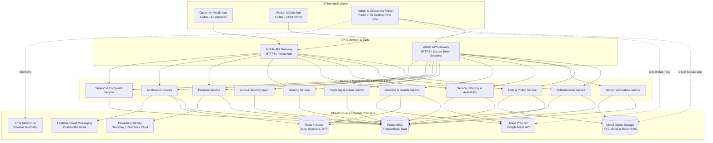
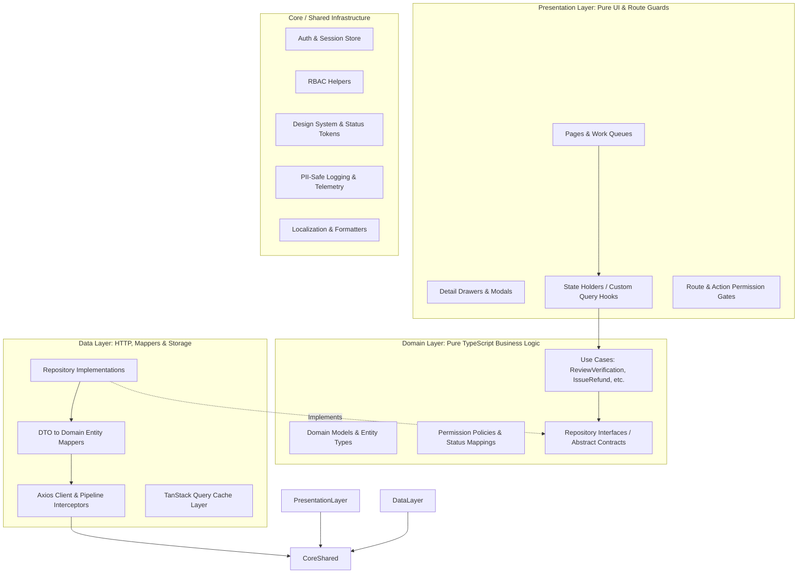
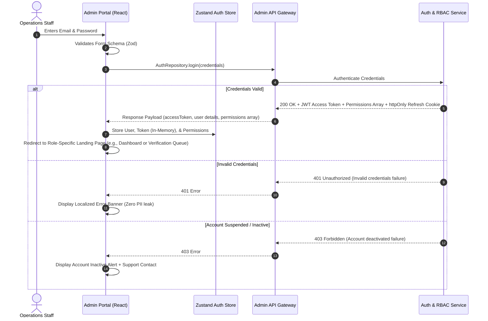
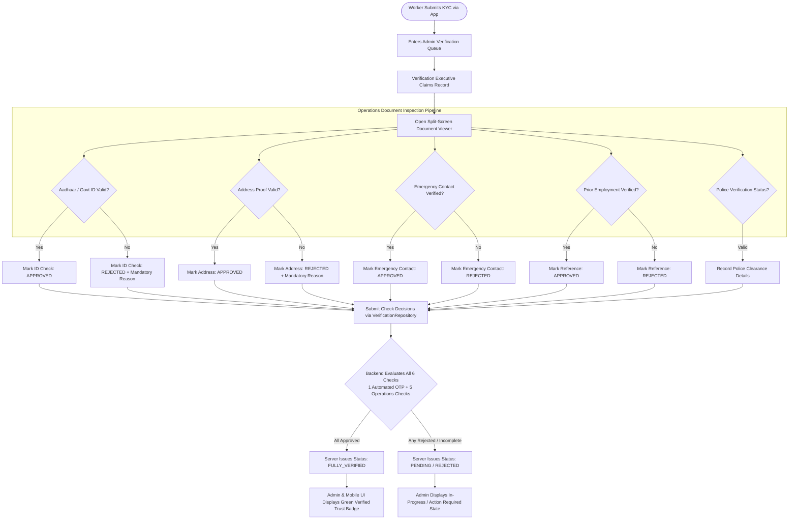
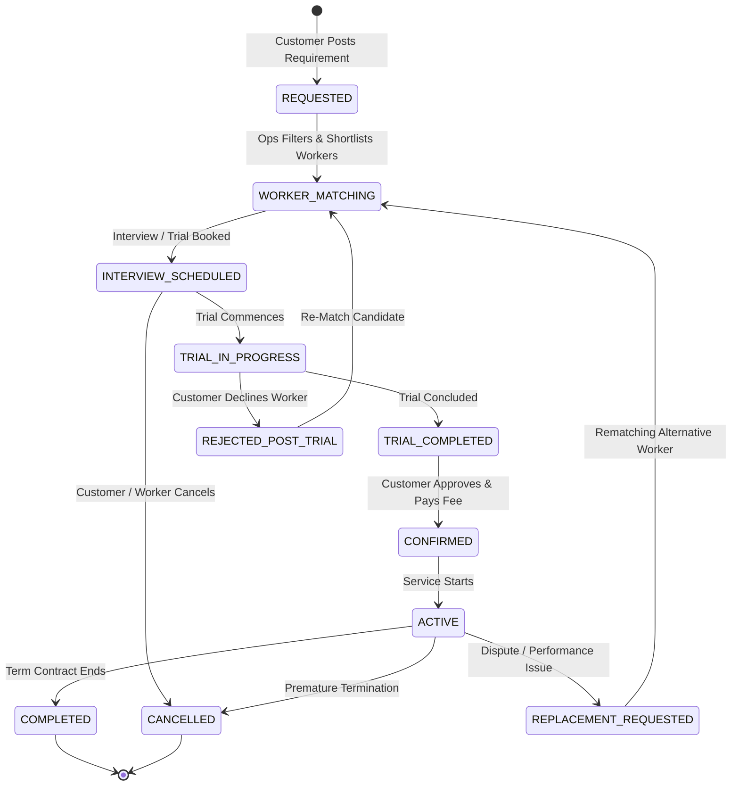
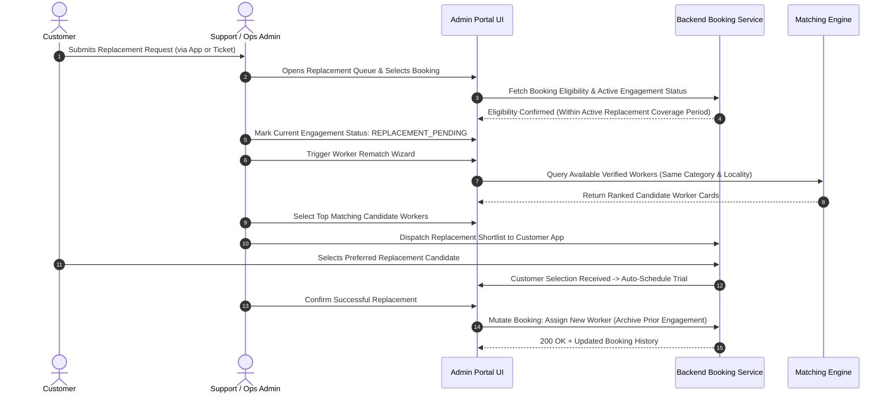
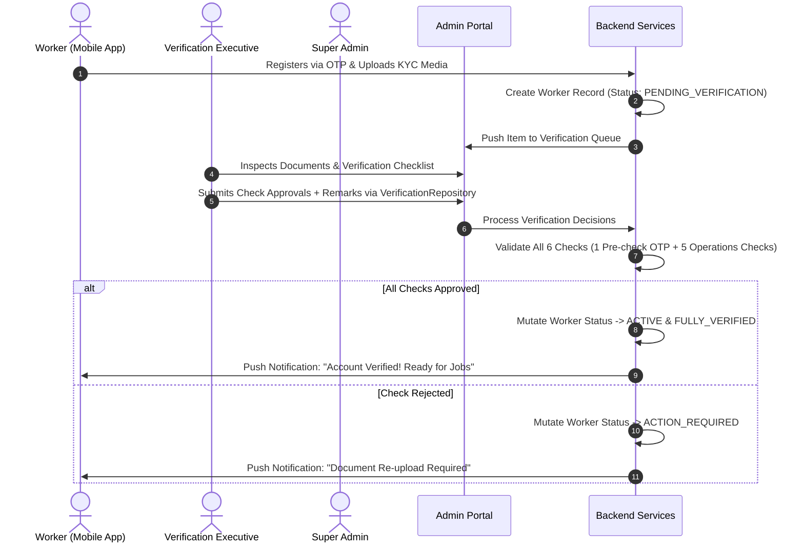
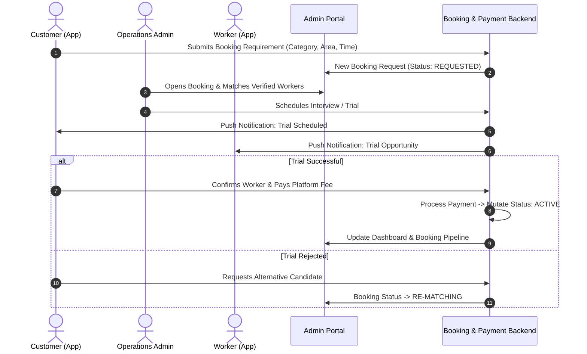
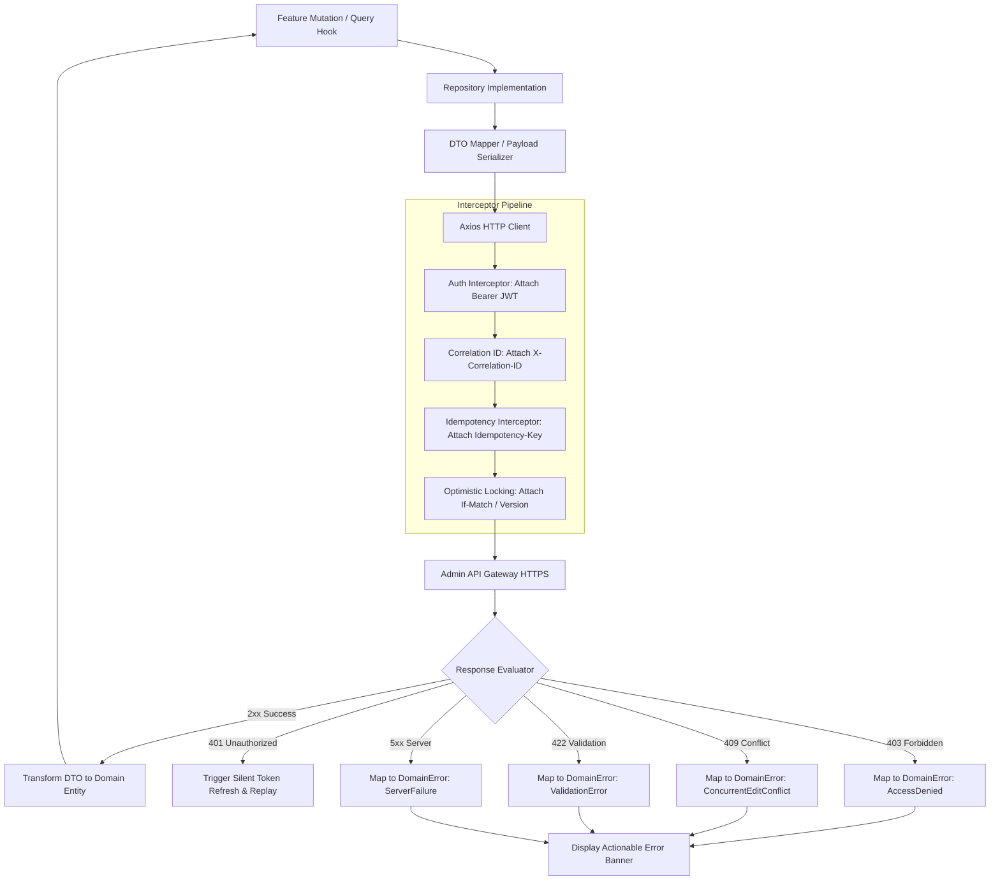
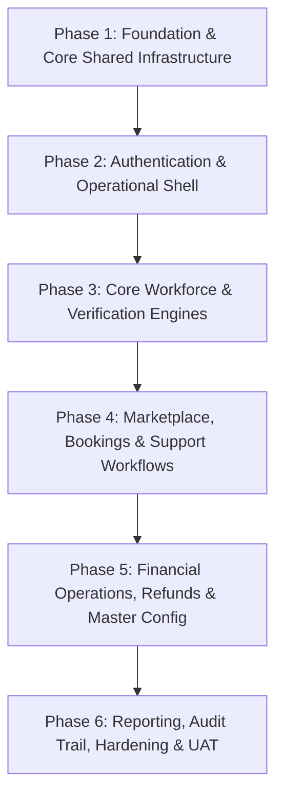

# SevaNest Admin Portal: Complete Workflow & Frontend Development Plan

> **Document Version:** 1.0.0  
> **Status:** Baseline Implementation & Operational Specification  
> **Target Audience:** Engineering Leads, Frontend Developers, Solution Architects, Business Analysts, QA Engineers, Operations & Verification Teams  
> **Source Documents:** *SevaNest Product Requirements Document (PRD)* & *SevaNest Admin Portal Frontend Architecture Document (v1.0)*

---

## 1. Document Overview

### 1.1 Purpose and Intended Audience
This document provides the authoritative, exhaustive technical workflow specification and module-by-module frontend development plan for the **SevaNest Web Admin & Operations Portal**. It synthesizes the operational, functional, and domain requirements established in the *SevaNest PRD* with the structural, security, and architectural mandates defined in the *SevaNest Admin Portal Frontend Architecture Document*.

This specification serves as the primary implementation blueprint for:
- **Frontend Engineers & Technical Leads:** For scaffolding, state structuring, routing, component development, and API integration.
- **Solution & Security Architects:** For verifying data privacy controls, session resilience, audit logging, and role-based access enforcement.
- **Business Analysts & Product Owners:** For validating workflow completeness, state machine integrity, and operational queue logic.
- **Quality Assurance & Testing Teams:** For constructing unit, component, integration, end-to-end, accessibility, and acceptance test suites.

### 1.2 Scope of the Document
This document covers the end-to-end frontend lifecycle and operational mechanics of the SevaNest Admin Portal, encompassing:
1. Complete system and domain architecture across Customer, Worker, Backend, and Admin surfaces.
2. Full technical stack, architectural patterns, separation of concerns, and data flow pipelines.
3. Detailed functional specifications for all core feature modules (Authentication, Dashboard, Customers, Workers, Verification, Bookings, Payments, Support, Reports, Configuration, Audit).
4. Cross-module operational lifecycles, status mapping vocabularies, and business state machines.
5. Reusable component specifications, data layer abstractions, error handling, and security controls.
6. A dependency-driven, phase-by-phase implementation sequence, module completion checklists, open technical decisions, and pre-implementation readiness gates.

### 1.3 Relationship Between the PRD and Frontend Architecture
- **The PRD (Product Requirements Document)** establishes *what* the business demands: user personas, service categories, multi-step verification safeguards, booking lifecycle stages, support SLAs, revenue streams, reporting requirements, and compliance parameters.
- **The Frontend Architecture Document** dictates *how* the Admin Portal must be built: a layered, feature-first React and TypeScript Single Page Application (SPA) where the backend remains the ultimate source of truth, permissions are server-evaluated, sensitive data is masked, and operations are strictly auditable.
- **This Document** unifies both sources into an actionable, comprehensive development plan without inventing unsupported API endpoints, backend schemas, or artificial date-based schedules.

### 1.4 Admin Portal Objectives
The SevaNest Admin Portal is designed to achieve four core operational goals:
1. **Accelerate Daily Marketplace Operations:** Provide high-throughput, filterable work queues (Pending KYC, New Requests, Escalated Complaints, Replacement Reviews) with clear visual indicators and one dominant action per row.
2. **Uphold the "Trust Before Verified" Principle:** Guarantee that no worker is presented or badged as verified until every single configured background check has been independently approved by authorized personnel and validated by the backend.
3. **Strict Role-Based & Privacy-Preserving Control:** Render interfaces, navigation items, and contextual actions strictly based on server-issued permissions, while masking Personally Identifiable Information (PII) and securing KYC documents behind audited, short-lived signed links.
4. **Auditability & Operational Safety:** Prevent accidental, unauthorized, or conflicting state mutations by requiring mandatory remarks for sensitive transitions, enforcing optimistic concurrency checks (versioning), attaching idempotency keys, and capturing an unalterable audit log.

### 1.5 Version 1 Scope vs. Out-of-Scope Capabilities

```
+---------------------------------------------------------------------------------------------------+
|                                      SEVANEST SCOPE BOUNDARY                                      |
+---------------------------------------------------------------------------------------------------+
|  IN SCOPE (VERSION 1)                                                                             |
|  - Web Admin Portal (React + TypeScript SPA)                                                      |
|  - Role-Based Access Control (Super Admin, Operations Admin, Verification Exec, Support Exec)     |
|  - V1 Categories: House Maid, Driver, Cook, Babysitter, Elderly Care Helper, Cleaning Helper       |
|  - Core Launch Market: Hyderabad pilot zones (HITEC City, Madhapur, Kondapur, Gachibowli, etc.)   |
|  - Multi-tier Worker Verification (Mobile, ID, Address, Emergency Contact, References, Police)    |
|  - Complete Booking Pipeline: Matching, Interviews/Trials, Confirmations, Active, Replacements    |
|  - Payment Transaction Monitoring, Fee Records & Audited Refund Processing                        |
|  - Ticketed Customer & Worker Support Management with Server-Reported SLA Tracking                |
|  - Configurable Master Management: Service Categories, Operational Areas, Fees, Plans, Templates  |
|  - Authoritative Audit Trail Viewer and Business Analytics Dashboards                             |
+---------------------------------------------------------------------------------------------------+
|  OUT OF SCOPE (POST-V1 / FUTURE ROADMAP)                                                          |
|  - Automated payroll processing and statutory payroll tax compliance                              |
|  - Worker micro-loans, wage advances, and credit products                                         |
|  - Integrated insurance underwriting marketplace                                                  |
|  - Facial-recognition attendance validation and GPS geofencing hardware                           |
|  - Complex autonomous AI recommendation / auto-assignment engine                                  |
|  - Full residential apartment-society ERP integration                                             |
|  - Advanced corporate bulk workforce management module                                            |
|  - Multi-country currency, taxation, and international operations                                  |
+---------------------------------------------------------------------------------------------------+
```

---

## 2. Complete Product and Admin Portal Overview

### 2.1 Ecosystem Overview
SevaNest operates as an integrated, three-sided marketplace and workforce management ecosystem connecting urban households with thoroughly vetted, reliable domestic workers:



### 2.2 System Interactions and Operational Responsibilities
1. **Customer Mobile App (Flutter):** Enables households to post requirements, filter verified workers across service categories, shortlist profiles, schedule interviews or trials, make fee payments, track ongoing engagements, rate workers, log support tickets, and request replacements.
2. **Worker Mobile App (Flutter):** Delivers a simplified, low-text, highly visual interface for domestic workers to register via mobile OTP, upload government identification and address documentation, declare skills and availability, receive job leads, manage trial/interview schedules, and track attendance/earnings.
3. **Backend Core Services (REST / HTTPS):** Enforces all domain invariants, permission rules, state machines, payment gateway webhooks, verification integrity checks, and immutable audit logs.
4. **Admin & Operations Portal (React SPA):** The command center utilized by Super Admins, Operations Admins, Verification Executives, and Support Executives to oversee, approve, arbitrate, and configure platform activities.

#### Operational Responsibilities of the Admin Portal
- **Verification Review:** Detailed inspection of worker KYC documents against reported metadata, recording structured approval/rejection remarks, and tracking expiry/re-check cycles.
- **Booking Orchestration:** Sourcing candidate workers for customer requirements, managing interview/trial statuses, arbitrating cancellations, and handling replacement fulfillment.
- **Financial & Refund Oversight:** Tracking transaction success/failure states, reconciling platform fees, and issuing authorized, audited refunds with mandatory rationale.
- **Support & Dispute Arbitration:** Triaging customer and worker complaints, enforcing SLA resolution deadlines, escalating complex grievances, and taking corrective account actions.
- **Dynamic Platform Configuration:** Updating service categories, geographical operational boundaries, commercial pricing models, subscription tiers, notification templates, and role privileges without requiring codebase deployments or app recompilation.

---

## 3. Technology Stack and Architecture

### 3.1 Stack Breakdown: Confirmed vs. Proposed vs. Open Items

| Architectural Area | Choice / Technology | Status | Technical Rationale & Specifications |
| :--- | :--- | :--- | :--- |
| **Framework & Language** | **React 18+, TypeScript** | **Confirmed (PRD)** | Standardized component model, strong typing across shared contracts, rich ecosystem for data-dense dashboards. |
| **Build Tooling** | **Vite** | **Proposed** | High-performance Hot Module Replacement (HMR), optimized Rollup-based tree-shaking, fast build times. |
| **Application Routing** | **React Router (v6+)** | **Proposed** | Declarative nested routing, data loader integration, layout nesting, declarative route guards. |
| **Server State Management** | **TanStack Query (v5)** | **Proposed** | Asynchronous state caching, automatic background refetching, query key invalidation, declarative mutations. |
| **Client / UI State** | **Zustand** | **Proposed** | Lightweight, boilerplate-free state stores for session tokens, navigation drawer states, active filter drafts. |
| **Form Management & Schema**| **React Hook Form + Zod** | **Proposed** | Uncontrolled performant form rendering, strict TypeScript-first schema validation, localized error mapping. |
| **HTTP & API Client** | **Axios with Interceptors** | **Proposed** | Centralized auth injection, token refresh loops, request correlation IDs, idempotency headers, standard domain error transformation. |
| **Data Tables** | **TanStack Table (v8)** | **Proposed** | Headless table logic supporting server-side sorting, complex column filtering, pagination, and virtual scrolling. |
| **Data Visualization** | **Recharts / ECharts** | **Proposed** | Responsive charting engine for administrative demand, conversion, utilization, and financial trend visualizations. |
| **UI Component Library** | *Accessible Primitive Library + Design Tokens* | **Open Item** | Open for architectural selection (e.g., Radix UI / Shadcn / headless custom primitives adhering to strict tokens). |
| **Session Model** | *In-memory token + httpOnly refresh cookie* | **Proposed** | Maximum resistance to XSS attacks; zero tokens stored in `localStorage` or `sessionStorage`. |
| **Document Storage Integration**| **Cloud Object Storage (Signed URLs)** | **Confirmed (PRD)**| Temporary, time-bounded (short-lived) signed links for KYC documents; no direct public URL access. |
| **Mapping & Geolocation** | **Google Maps JavaScript API** | **Confirmed (PRD)**| Visualizing operational cluster polygons, address pins, and service coverage zones. |
| **Internationalization (i18n)**| **react-i18next** | **Proposed** | English (en-IN) primary for V1; structured JSON token architecture enabling straightforward multi-language rollout. |
| **Telemetry & Observability** | **Cloud Logging + Browser Telemetry** | **Confirmed (PRD)**| Captures client runtime errors linked via correlation IDs; strict PII scrubbing before egress. |
| **Testing Toolchain** | **Vitest, Testing Library, MSW, Playwright**| **Proposed** | Complete test pyramid: unit (Vitest), component (Testing Library), API mocking (MSW), E2E workflows (Playwright). |

### 3.2 Layered Architecture and Separation of Concerns

The SevaNest Admin Portal enforces a strict 4-tier layered architecture. Data and dependencies flow strictly downwards. The Presentation Layer uses the Domain Layer, and the Data Layer implements Domain contracts.



#### Layer Boundary Rules

```
+----------------------------------------------------------------------------------------------------+
|                                    LAYER RESPONSIBILITY MATRIX                                     |
+----------------------------------------------------------------------------------------------------+
| LAYER          | RESPONSIBILITIES                           | PROHIBITED BEHAVIORS                 |
+----------------+--------------------------------------------+--------------------------------------+
| PRESENTATION   | - Render view templates, tables, forms     | - NO direct Axios or HTTP invocations|
|                | - Capture user events and trigger hooks    | - NO domain business validation rules|
|                | - Manage layout shell, breadcrumbs, routing| - NO direct DTO shape manipulation   |
|                | - Display loading, empty, and error states | - NO role name string checks         |
+----------------+--------------------------------------------+--------------------------------------+
| DOMAIN         | - Define pure TypeScript entity models     | - NO React imports or hooks          |
|                | - Encapsulate validation and use cases     | - NO DOM or browser API dependencies |
|                | - Declare abstract repository interfaces   | - NO HTTP client or fetch utilities  |
|                | - Define permission keys and status maps   | - NO UI presentation markup          |
+----------------+--------------------------------------------+--------------------------------------+
| DATA           | - Implement repository interfaces          | - NO direct UI component coupling    |
|                | - Execute HTTP requests via Axios client   | - NO leaking raw DTOs to UI          |
|                | - Map raw DTO responses into Domain models | - NO bypassing domain error models   |
|                | - Configure Query Keys and cache lifetimes |                                      |
+----------------+--------------------------------------------+--------------------------------------+
| CORE / SHARED  | - Base HTTP client and interceptor pipeline| - NO feature-specific business logic |
|                | - Centralized auth & session abstractions  | - NO domain entity declarations      |
|                | - Stateless design system primitives       |                                      |
|                | - Date/Time (IST), Currency (INR) utils    |                                      |
+----------------+--------------------------------------------+--------------------------------------+
```

---

## 4. Admin Portal Navigation and Layout

### 4.1 Layout Shell Structure
The Admin Portal layout is designed as a desktop-optimized, responsive operations console:
- **Top Header Bar:** 
  - Organization branding & environment badge (`DEV`, `STAGE`, `PROD`).
  - Global Search Input (omnipresent search for Customer ID, Worker ID, Booking Ref, Ticket ID).
  - Quick action alerts (Pending KYC count, Open Escalations count).
  - User profile menu: Staff name, assigned role badge, active session indicator, and Logout trigger.
- **Collapsible Sidebar Navigation:**
  - Grouped into distinct logical functional sections (`Operations`, `People`, `Money & Insight`, `Control`).
  - Strict conditional rendering based on active server-issued permissions.
  - Active route highlighting and badge counters for pending items.
- **Main Content Area:**
  - Dynamic breadcrumb trail with one-click navigation to parent entities.
  - Action header (Page title, subtitle context, contextual primary/secondary CTA buttons).
  - Main viewport hosting work queues, data tables, analytical charts, or split-screen review drawers.

### 4.2 Sidebar Menu Structure & Role Visibility

```
+---------------------------------------------------------------------------------------------------+
| SIDEBAR NAVIGATION TAXONOMY                                                                       |
+---------------------------------------------------------------------------------------------------+
| SECTION        | MODULE / ROUTE             | REQUIRED PERMISSION KEY     | DEFAULT ROLES         |
+----------------+----------------------------+-----------------------------+-----------------------+
| Operations     | Dashboard & Queues         | dashboard.view              | Super, Ops, Verif, Supp|
|                | Verification Review        | verification.review         | Super, Ops, Verif      |
|                | Booking Pipeline           | bookings.view               | Super, Ops, Supp       |
|                | Support Tickets            | support.view                | Super, Ops, Supp       |
+----------------+----------------------------+-----------------------------+-----------------------+
| People         | Customers Directory        | customers.view              | Super, Ops, Supp       |
|                | Workers Directory          | worker.view                 | Super, Ops, Verif, Supp|
|                | Document Vault             | documents.view_restricted   | Super, Ops, Verif      |
|                | Suspension & Blacklist     | workers.manage_status       | Super, Ops            |
+----------------+----------------------------+-----------------------------+-----------------------+
| Money & Insight| Transactions & Fees        | payments.view               | Super, Ops, Supp       |
|                | Refund Processing          | refunds.manage              | Super, Ops            |
|                | Reports & Analytics        | reports.view                | Super, Ops, Supp       |
|                | Data Exports               | exports.generate            | Super, Ops            |
+----------------+----------------------------+-----------------------------+-----------------------+
| Control        | Service Categories & Areas | configuration.manage        | Super Admin           |
|                | Fees, Plans & Templates    | configuration.manage        | Super Admin           |
|                | Roles & Permissions Matrix | roles.manage                | Super Admin           |
|                | Audit Trail Logs           | audit.view                  | Super Admin           |
+----------------+----------------------------+-----------------------------+-----------------------+
```

### 4.3 Navigation Rules, URL Sync, and Deep Linking
1. **URL as Single Source of Truth for List State:** All table filters, active tab selections, search queries, column sorting parameters, and pagination offsets are continuously synchronized with the browser URL query parameters.
2. **Bookmarking & Session Restoration:** Staff members can bookmark, refresh, or share deep links. Upon opening, the portal initializes the TanStack Table state directly from the URL parameters.
3. **Breadcrumbs and Back Navigation:** Detail screens maintain an explicit parent link and breadcrumb hierarchy ensuring no operational context is lost.
4. **Declarative Route Guards & No-Access Handling:** Direct navigation to a URL for which the authenticated user lacks permissions does not crash or silently fail. It renders a clean, accessible `NoAccessView` displaying the required permission, the user's current privileges, and a CTA to return to the designated role landing page.

---

## 5. Authentication & Session Module

### 5.1 Sign-in and Session Initialization Flow
The authentication module provides secure, role-evaluated access for administrative personnel. The Admin Portal uses email and password credentials, returning an authenticated session containing authorized permission keys.



### 5.2 Session Management & Token Expiry Pipeline
- **In-Memory Storage:** The short-lived JWT access token is stored exclusively in client memory (Zustand store). It is **never** written to `localStorage`, `sessionStorage`, or unencrypted cookies.
- **Silent Refresh Interceptor:** The Axios client intercepts outgoing requests. If a request returns a `401 Unauthorized` indicating token expiration, an automatic quiet refresh call (`AuthRepository.refreshToken()`) is executed using the secure `httpOnly` refresh cookie.
- **Mid-Form Expiry & Draft Preservation:** If a silent refresh fails while an administrator is actively editing a form (e.g., submitting verification remarks or configuring a fee schedule), the portal retains the form state in local memory, presents an inline session re-authentication modal, and replays the pending submission with an idempotency key once authenticated.

---

## 6. Dashboard & Operations Console Module

### 6.1 Purpose and Key Metric Indicators (KPIs)
The dashboard provides a high-level operational overview and prioritized work queues tailored to the logged-in user's role. All aggregate metrics and counts are strictly computed and provided by the backend reporting service.

```
+----------------------------------------------------------------------------------------------------+
| SEVANEST OPERATIONS DASHBOARD                                                                      |
+----------------------------------------------------------------------------------------------------+
| [ KPI CARDS ]                                                                                      |
| +--------------------+ +--------------------+ +--------------------+ +--------------------+       |
| | Total Bookings     | | Active Workers     | | Pending KYC Review | | Open Complaints    |       |
| | Aggregate Count    | | Online / Roster    | | Awaiting Action    | | SLA Tracked Count  |       |
| +--------------------+ +--------------------+ +--------------------+ +--------------------+       |
| +--------------------+ +--------------------+ +--------------------+ +--------------------+       |
| | Replacement Reqs   | | Platform Revenue   | | Scheduled Trials   | | Police Verif Due   |       |
| | Under Review Count | | Gross Collections  | | Active Trial Count | | Pending Follow-up  |       |
| +--------------------+ +--------------------+ +--------------------+ +--------------------+       |
+----------------------------------------------------------------------------------------------------+
| [ REAL-TIME OPERATIONAL QUEUES ]                                                                   |
| [Tab: Pending Verification] [Tab: Escalated Tickets] [Tab: Replacement Requests]                   |
| +------------------------------------------------------------------------------------------------+ |
| | Worker / Record ID | Category   | Submission Time | Status          | Dominant Quick Action    | |
| |--------------------+------------+-----------------+-----------------+--------------------------| |
| | Worker Record ID   | Role Name  | Time Elapsed    | Documents Ready | [Review KYC Documents]   | |
| | Worker Record ID   | Role Name  | Time Elapsed    | Address Pending | [Review KYC Documents]   | |
| | Booking Record ID  | Role Name  | Time Elapsed    | Replace Asked   | [Assign Replacement]     | |
| +------------------------------------------------------------------------------------------------+ |
+----------------------------------------------------------------------------------------------------+
```

### 6.2 Operational Queue Tabs & View States
1. **Pending KYC Verification Queue:** Displays worker applications awaiting document inspection, sorted oldest-first. Row action routes directly to the split-screen verification viewer.
2. **Escalated Complaints Queue:** Surfaces customer and worker support tickets approaching or exceeding SLA thresholds. Row action opens the ticket resolution drawer.
3. **Replacement Request Queue:** Highlights active service disruptions requiring urgent worker rematching.
4. **State Handling:**
   - **Loading State:** Skeleton KPI cards and skeleton table rows matching standard layout dimensions.
   - **Empty State:** Clean illustration with "All queues clear. No pending items requiring attention."
   - **Error State:** Banner indicating "Unable to load dashboard metrics. [Retry]" with automated exponential backoff retry.
   - **Access Denied:** Fallback to role-authorized landing view.

---

## 7. Customer Management Module

### 7.1 Customer Directory & Filtering
- **Search Capabilities:** Indexed search across Customer Name, Mobile Number, Email Address, and Customer Unique ID.
- **Filter Parameters:** Account Status (`ACTIVE`, `SUSPENDED`, `BLOCKED`), Registration Date Range, Geographic Locality (e.g., Gachibowli, Kondapur), and Active Booking Status.
- **Pagination & Sorting:** Server-side pagination with default page size of 25 records; sortable by Registration Date, Total Bookings, and Lifetime Spend.

### 7.2 Customer Profile & Sensitive Data Governance
- **Contact Information Display:** In standard directory views, mobile numbers and email addresses are masked.
- **Authorized Reveal Workflow:** Staff with `customers.reveal_pii` permission can click a reveal button. The action prompts for a mandatory business reason, decrypts the contact for that specific view session, and generates an immediate audit log entry.
- **Saved Address Directory:** Displays customer residential locations with mapped landmark metadata and Google Maps coordinate pins.

### 7.3 Profile Sub-views & Operational History
1. **Engagement & Booking History:** Chronological data table listing all historical bookings, assigned workers, service categories, engagement tenures, and final booking outcomes (`COMPLETED`, `CANCELLED`, `REPLACED`).
2. **Financial & Payment Ledger:** Record of all platform fees, subscription payments, and refund transactions associated with the customer, linked to Payment Management.
3. **Support & Complaint Log:** Detailed history of all support tickets logged by the customer, including dispute categories, resolution times, and staff notes.
4. **Internal Staff Notes:** Free-text internal notes system for operational handover. Every note records the authoring staff ID, timestamp, and immutable note content.
5. **Administrative Actions:** Authorized administrators (`customers.manage_status`) can perform `Suspend Account` or `Reactivate Account` actions, each requiring mandatory categorization and remarks.

---

## 8. Worker Management Module

### 8.1 Worker Directory & Profile Architecture
The Worker Management module tracks household staff profiles across their complete platform lifecycle.

```
+----------------------------------------------------------------------------------------------------+
| WORKER PROFILE: W-10482 - Lakshmi Devi                                                            |
| Status: ACTIVE | Verification: FULLY VERIFIED (1 Pre-check + 5 Ops Checks) | Overall Rating: 4.8 / 5.0 |
+----------------------------------------------------------------------------------------------------+
| [Primary Roles]: House Maid, Cook (North/South Indian) | [Preferred Areas]: Madhapur, Gachibowli    |
| [Experience]: 7 Years | [Languages]: Telugu, Hindi, Basic English | [Salary Exp]: INR Specified    |
| [Availability]: Full-Time (Live-out)                   | [Current Booking]: Active Service         |
+----------------------------------------------------------------------------------------------------+
| TABS: [1. KYC & Verification] [2. Work History & Bookings] [3. Ratings & Reviews] [4. Admin Actions]|
|                                                                                                    |
| TAB 1: KYC & VERIFICATION STATUS CHECKLIST                                                         |
| - Mobile OTP Pre-check:       [PASSED - Automated Verification at Onboarding]                      |
| - Operations Identity Check:  [PASSED - Reviewed by Authorized Staff] [View Signed Document]       |
| - Operations Address Check:   [PASSED - Reviewed by Authorized Staff] [View Signed Document]       |
| - Operations Emergency Contact:[PASSED - Family Contact Verified via Call]                         |
| - Operations Reference Check: [PASSED - Prior References Contacted & Recorded]                     |
| - Operations Police Tracking: [TRACKED - Certificate Uploaded & Monitored]                         |
|                                                                                                    |
| TAB 4: ADMINISTRATIVE STATUS CONTROLS                                                              |
| Current Status: ACTIVE                                                                             |
| Action Options: [Suspend Worker] [Blacklist Worker]                                                |
| Remarks (Mandatory): [ Enter detailed operational reason for status change...                    ] |
| Confirmation: [X] I confirm this action complies with SevaNest Safety & Operational Guidelines     |
| Button: [EXECUTE STATUS MUTATION]                                                                  |
+----------------------------------------------------------------------------------------------------+
```

### 8.2 Operational Profile Attributes
- **Skills & Categories:** Structured tagging of specific competencies (e.g., Deep Cleaning, Infant Care, Elderly Mobility Assistance, Vegetarian Cooking, Automatic Car Driving).
- **Geographic Coverage:** Multi-select assignment of operational zones and maximum travel radius.
- **Salary & Engagement Preferences:** Expected remuneration, preferred shifts (Morning, Evening, Live-in, Live-out).
- **Ratings & Reviews:** Aggregate customer ratings score, distribution histogram, and individual feedback comments with booking references.
- **Disciplinary Workflows:** `Suspend Worker` and `Blacklist Worker` mutations enforce two-person visibility, mandatory category tagging (e.g., `MISCONDUCT`, `UNAUTHORIZED_ABSENCE`, `SAFETY_BREACH`), detailed text remarks, and immediate revocation of worker app job feeds.

---

## 9. Verification & Trust Framework Module

### 9.1 The "Trust Before Verified" Operational Journey
Trust is the central pillar of the SevaNest platform. The Admin Portal frontend is strictly prohibited from computing or displaying a "Verified" status badge based on partial local state. The verification badge is rendered **only** when the server reports that all platform-mandated verification checks have been fully approved.



### 9.2 Verification Sub-Checks Matrix: Automated Pre-Check vs. 5 Operations Checks

Worker verification is explicitly partitioned into two structural tiers:
1. **Automated Onboarding Pre-Check:** Telecom carrier mobile OTP verification completed during app signup.
2. **Operations-Reviewed Trust Checks (5 Discrete Checks):** Mandatory checks manually evaluated or tracked by operations personnel.

```
+----------------------------------------------------------------------------------------------------+
| VERIFICATION CHECK SPECIFICATION TABLE                                                             |
+----------------------------------------------------------------------------------------------------+
| TIER & CHECK TYPE        | REQUIRED SOURCE DATA         | EVALUATION METHOD & ACTION | RECHECK FREQUENCY   |
+--------------------------+------------------------------+----------------------------+---------------------+
| [Pre-Check] Mobile OTP   | Telecom Carrier Verification | Automated at Onboarding    | Re-verify on change |
| [Check 1] Identity Check | Aadhaar / Voter ID / Passport| Manual document review     | Recheck on update   |
| [Check 2] Address Check  | Utility Bill / Rent Agreement| Locality & address review  | Periodic re-check   |
| [Check 3] Emergency Cont.| Family Contact Name & Phone  | Manual call verification   | Periodic check      |
| [Check 4] Employment Ref | Previous Employer Details    | Telephonic reference call  | Milestone check     |
| [Check 5] Police Verif.  | Police Clearance Certificate | Tracking & cert inspection | Expiry tracking     |
+----------------------------------------------------------------------------------------------------+
```

### 9.3 Secure Document Viewer & Privacy Controls
- **Signed URL Lifecycle:** When an executive opens a document for review, the frontend requests a short-lived signed link via `VerificationRepository.getSignedDocumentUrl(documentId)`. The link expires quickly and is never stored in browser persistence.
- **Inline Rendering:** The document viewer renders images and PDFs within a secure modal with print/download disabled for standard reviewer roles.
- **Audit Logging:** Every single document viewing event is dispatched to the backend audit log recording the executive's User ID, Worker ID, Document ID, and timestamp.

---

## 10. Booking Management Module

### 10.1 Complete Booking Lifecycle State Machine
The booking pipeline coordinates customer requirements with available verified workers. The frontend reflects server-driven transitions without inventing local states.



### 10.2 Canonical Status Label Mapping
Adhering to the *Frontend Architecture Document* (Page 9), the Admin Portal uses a centralized mapping class to translate raw backend enum statuses into plain, accessible administrative labels, icons, and allowed actions:

```
+----------------------------------------------------------------------------------------------------+
| CANONICAL STATUS LABEL MAPPING TABLE (FROM ARCHITECTURE SPECIFICATION)                            |
+----------------------------------------------------------------------------------------------------+
| FUNCTIONAL DOMAIN        | BACKEND ENUM STATUS (EXAMPLES)  | ADMIN DISPLAY LABEL       | BADGE COLOR TOKEN |
+--------------------------+---------------------------------+---------------------------+-------------------+
| Verification             | `Pending`                       | Pending review            | Amber Neutral     |
| Verification             | `In review`                     | In review                 | Blue In-Progress  |
| Verification             | `Approved` / `Rejected`         | Approved / Rejected       | Green / Red       |
| Verification             | `Expiry due`                    | Re-check due              | Orange Warning    |
| Worker                   | `Suspended` / `Blacklisted`     | Suspended / Blacklisted   | Red Destructive   |
| Booking                  | `Requested`                     | New request               | Purple Informative|
| Booking                  | `Interview / trial scheduled`   | Interview set             | Blue Accent       |
| Booking                  | `Confirmed`                     | Worker confirmed          | Green Success     |
| Booking                  | `Active`                        | Service active            | Green Dark        |
| Booking                  | `Replacement requested`         | Replacement review        | Orange Warning    |
| Payment                  | `Success` / `Failed`            | Paid / Payment failed     | Green / Red       |
| Payment                  | `Refund pending`                | Refund pending            | Amber Alert       |
| Support Ticket           | `Escalated` / `SLA breached`    | Escalated / SLA breached  | Red Urgent        |
+----------------------------------------------------------------------------------------------------+
```

### 10.3 Booking Management Operational Workflows
1. **New Requirement Triage:** Operations Admins review incoming requests detailing category, locality, timing, family requirements, and salary budget.
2. **Worker Shortlisting & Matching:** The portal provides a matching interface filtering workers who are:
   - `FULLY_VERIFIED` (All 6 checks passed)
   - Active and currently available for the requested time slots
   - Within the defined geographic operational zone
   - Matching language and skill prerequisites
3. **Interview & Trial Scheduling:** Staff coordinate telephonic or in-person trials, selecting date, time, and location. Automated push notifications are dispatched to Customer and Worker apps.
4. **Booking Confirmation & Platform Fee:** Upon successful trial, the customer confirms the match and pays the applicable platform/booking fee via the integrated payment gateway.
5. **Timeline Audit Trail:** Every booking screen displays an interactive chronological timeline reflecting all status mutations, scheduling changes, assigned staff members, and system notifications.

---

## 11. Payments and Refunds Module

### 11.1 Financial Ledger & Transaction Tracking
- **Gateway Abstraction:** The Admin Portal interacts exclusively with the backend Payment Service. No payment gateway SDKs (e.g., Razorpay, Cashfree, PayU), private API keys, or cardholder data exist within the frontend codebase.
- **Transaction Table:** Displays Transaction ID, Customer Name, Booking Reference, Fee Category (Booking Fee, Placement Fee, Subscription), Transaction Amount (formatted in INR), Payment Method (UPI, Net Banking, Card), Gateway Reference Number, and Status (`INITIATED`, `PROCESSING`, `PAID`, `FAILED`, `REFUNDED`).

### 11.2 Audited Refund Processing Workflow
Refunds represent sensitive financial transactions and require strict operational safeguards:

```
+----------------------------------------------------------------------------------------------------+
| REFUND PROCESSING DIALOG                                                                          |
+----------------------------------------------------------------------------------------------------+
| Transaction ID: TXN-892104 | Original Amount: Rs. 1,500.00 | Status: Completed                    |
| Customer: Anand Sharma (C-1092) | Associated Booking: B-8901 (Cancelled Post-Trial)                |
+----------------------------------------------------------------------------------------------------+
| Refund Type:       (o) Full Refund (Rs. 1,500.00)     ( ) Partial Refund                           |
| Refund Amount:     [ Rs. 1,500.00                                                                ] |
| Reason Category:   [ Select Reason: Worker No-Show / Customer Cancellation / Unsatisfactory Trial v] |
| Operational Notes: [ Enter detailed justification for finance audit records...                   ] |
| Idempotency Key:   [ Auto-generated Client Mutex / Request UUID                                  ] |
+----------------------------------------------------------------------------------------------------+
| [X] I confirm that this refund has been authorized under SevaNest Commercial Cancellation Policies |
|                                                                                                    |
| [ CANCEL ]                                                          [ CONFIRM & PROCESS REFUND ]   |
+----------------------------------------------------------------------------------------------------+
```

### 11.3 Financial Export Security
- **Server-Generated Exports:** Financial reports and invoice summaries are requested via the portal, compiled securely on the backend, and delivered as audited downloads.
- **PII Masking in Exports:** Exported financial ledgers automatically mask customer personal phone numbers and payment instrument details unless explicitly approved for executive finance roles.

---

## 12. Support & Complaints Module

### 12.1 Ticket Lifecycle & SLA Management
The Support module enables support executives to arbitrate disputes, address service quality issues, and maintain operational SLAs.

```
+----------------------------------------------------------------------------------------------------+
| SUPPORT TICKET: TKT-4921 - Customer Reports Unannounced Worker Absence                             |
| Status: ESCALATED | Priority: HIGH | SLA Deadline: Approaching Breach | Owner: Staff E-108 (Pooja S)|
+----------------------------------------------------------------------------------------------------+
| Complainant: Customer - Rajesh Kumar (C-4812) | Subject Worker: Sunita Devi (W-3819)               |
| Related Booking: B-7712 (Active Maid Service) | Category: ATTENDANCE_BREACH                        |
+----------------------------------------------------------------------------------------------------+
| TICKET TIMELINE & INTERNAL COMMUNICATION                                                           |
| -------------------------------------------------------------------------------------------------- |
| [Event 1 / Ticket Opened] Customer raised ticket via Customer App: "Maid did not arrive today."    |
| [Event 2 / Triage]        Ticket auto-assigned to Support Queue. Initial SLA countdown started.    |
| [Event 3 / Contact Check] Staff Pooja S: Called worker. Phone unreachable. Emergency contact dialed|
| [Event 4 / Escalation]    Ticket escalated to High Priority due to impending SLA deadline.         |
| -------------------------------------------------------------------------------------------------- |
| STAFF ACTION CONSOLE                                                                               |
| Update Status:  [ ESCALATED -> IN_PROGRESS / RESOLVED / CLOSED                                   v] |
| Reassign Owner: [ Pooja S (Support Executive)                                                    v] |
| Add Case Note:  [ Worker contacted via family; medical emergency. Replacement offered to customer] |
| Action Button:  [ [Offer Free Replacement] ]  [ [Initiate Partial Refund] ]  [ [Close Ticket] ]     |
+----------------------------------------------------------------------------------------------------+
```

### 12.2 SLA Visibility & Breach Flags
- **Server-Calculated Timers:** All SLA timers, elapsed durations, and breach indicators are calculated by the backend service. The frontend displays dynamic countdown chips:
  - `Normal` (Green): > 50% SLA duration remaining.
  - `At Risk` (Amber): < 25% SLA duration remaining.
  - `Breached` (Red): SLA deadline exceeded.
- **Customer & Worker Profile Linking:** Every ticket is permanently cross-referenced against both the customer and worker profiles to track chronic dispute trends or repeated misconduct.

---

## 13. Replacement Management Workflow

### 13.1 Operational Replacement Sequence
When an active domestic worker relationship breaks down (e.g., skill mismatch, prolonged absence, behavioral issue), the replacement engine ensures rapid, auditable remediation.



### 13.2 Data Preservation & History Retention
- **Non-Destructive Reassignment:** Initiating a replacement never deletes or overwrites the original booking record.
- **Engagement Chaining:** The platform creates a linked secondary engagement record preserving the original worker's start/end dates, ratings, and performance remarks, ensuring full auditability.

---

## 14. Reports & Analytics Module

### 14.1 Complete PRD Report Specifications
The Admin Portal provides data visualization and reporting interfaces for all 12 core business report domains specified in the SevaNest PRD (presented across 13 focused administrative report views):

```
+----------------------------------------------------------------------------------------------------+
| SEVANEST REPORTING CATALOGUE                                                                       |
+----------------------------------------------------------------------------------------------------+
| REPORT IDENTIFIER                 | PRIMARY DIMENSIONS             | METRICS & VISUALIZATION       |
+-----------------------------------+--------------------------------+-------------------------------+
| 1. New Customer Acquisition       | Time Period, Locality          | Growth curves, Signups, KYC % |
| 2. Worker Registration & Funnel   | Acquisition Source, Category   | Drop-off funnel chart         |
| 3. Verification Conversion        | Reviewer Staff, Document Type  | Approval vs Rejection rates   |
| 4. Booking Requests vs Confirmed  | Category, Operational Zone     | Conversion ratio bar chart    |
| 5. Category-Wise Demand           | Category (Maid, Driver, etc.)  | Volume distribution pie/bar   |
| 6. Area-Wise Demand & Heatmap     | Locality (HITEC, Kondapur, etc)| Geographic cluster density    |
| 7. Worker Utilization Rate        | Category, Engagement Type      | % Active vs Idle workforce    |
| 8. Interview-to-Confirmation Rate | Category, Worker Experience    | Trial success conversion %    |
| 9. Cancellation Rate Analysis     | Cancellation Reason, Stage     | Attrition rate timeline       |
| 10. Replacement Rate Trends       | Category, Tenure, Reason       | % Replacements per 100 jobs   |
| 11. Payment Collections & Fees    | Fee Type, Payment Method       | Gross transaction value (INR) |
| 12. Support Ticket SLA Resolution | Category, Priority, Staff ID   | Mean Time to Resolve (MTTR)   |
| 13. Top-Rated Workers & Repeat Cust| Worker Rating, Repeat Hires   | Leaderboards & retention rate |
+----------------------------------------------------------------------------------------------------+
```

### 14.2 Reporting Controls & Asynchronous Export Architecture
- **Configurable Filters:** Date range picker (Custom IST Range, Pre-configured relative ranges), Category Selector, Locality Multi-select, and Role/Staff filters.
- **Asynchronous Export Generation:** Export requests for large datasets (CSV, Excel, PDF) are queued asynchronously. The portal displays a progress badge, notifies the user upon job completion, and delivers a secure, audited download link.

---

## 15. Configuration & Platform Masters Module

### 15.1 Dynamic Master Data Management
The Configuration module provides Super Admins with tools to adjust business parameters without application redeployment or code modifications.

```
+----------------------------------------------------------------------------------------------------+
| PLATFORM CONFIGURATION CONSOLE                                                                     |
+----------------------------------------------------------------------------------------------------+
| CONFIGURATION SECTIONS:                                                                            |
| [1. Service Categories] [2. Operational Areas] [3. Fees & Pricing Plans] [4. Templates] [5. Roles] |
|                                                                                                    |
| SECTION 3: EDIT FEES & COMMERCIAL PLANS                                                            |
| Current Active Draft: Draft Configuration Package                                                  |
|                                                                                                    |
| Fee Parameter                     | Live Value          | Proposed Draft Value                     |
| ----------------------------------+---------------------+----------------------------------------- |
| Maid One-Time Booking Fee         | Current Baseline    | Adjusted Value                           |
| Driver Monthly Placement Fee      | Current Baseline    | Current Baseline (Unchanged)             |
| Extended Replacement Plan Fee     | Current Baseline    | Adjusted Value                           |
|                                                                                                    |
| DIFF PREVIEW & REASON CAPTURE                                                                      |
| Change Rationale (Mandatory):     [ Operational fee structure update for pilot launch           ] |
| Validation Status:                [PASSED - All fee values within allowed domain bounds]           |
|                                                                                                    |
| Action Buttons: [Discard Draft]   [Preview Impact]   [PUBLISH CONFIGURATION TO LIVE APPS]          |
+----------------------------------------------------------------------------------------------------+
```

### 15.2 Master Sub-Modules
1. **Service Categories:** Configure active roles (Maid, Driver, Cook, etc.), sub-skills checklist, engagement types (Live-in, Full-time, Part-time, Hourly), and minimum experience requirements.
2. **Operational Areas & Geofences:** Manage supported cities (Hyderabad V1) and active cluster boundaries (HITEC City, Madhapur, Kondapur, Gachibowli, Kukatpally).
3. **Fees & Commercial Plans:** Edit booking fees, placement fees, customer subscription packages, and replacement extension pricing.
4. **Notification Templates:** Configure message copy and parameter variables across Push Notifications, SMS, and optional WhatsApp channels.
5. **Role & Permission Matrix:** Manage granular permission assignments across system roles, with changes taking effect upon next token refresh.

---

## 16. Audit Trail & Compliance Module

### 16.1 Centralized Audit Log Viewer
The Audit module provides an immutable, chronologically ordered record of all sensitive, operational, and administrative mutations executed across the platform.

```
+----------------------------------------------------------------------------------------------------+
| PLATFORM AUDIT LOG VIEWER                                                                          |
+----------------------------------------------------------------------------------------------------+
| Search Filters: [Actor ID / Name: ______] [Action Type: ALL v] [Target Entity ID: ______] [Filter] |
+----------------------------------------------------------------------------------------------------+
| Timestamp (IST)   | Actor           | Action Type         | Target Record | Change Summary / Notes |
|-------------------+-----------------+---------------------+---------------+------------------------|
| Chronological Log | E-102 (Verif)   | VERIF_APPROVE_DOC   | W-10482 (Doc) | Approved Aadhaar ID    |
| Chronological Log | E-101 (Super)   | CONFIG_PUBLISH_FEES | CFG-FEES-V2   | Updated Booking Fee    |
| Chronological Log | E-104 (Ops)     | REFUND_PROCESSED    | TXN-892104    | Issued Fee Refund      |
| Chronological Log | E-104 (Ops)     | WORKER_SUSPEND      | W-3819        | Suspended: Misconduct  |
| Chronological Log | E-108 (Supp)    | PII_REVEAL_CONTACT  | C-1092        | Revealed Phone: Ticket |
+----------------------------------------------------------------------------------------------------+
```

### 16.2 Audited Event Triggers
1. **Verification Decisions:** Every document approval, rejection, and text remark.
2. **User Status Modifications:** Customer/Worker account suspensions, reactivations, and blacklist operations.
3. **Financial Mutations:** Refund issuances, fee adjustments, and manual ledger reconciliations.
4. **Configuration Publishes:** Every modification to categories, areas, pricing plans, and permissions.
5. **PII Reveal Actions:** Every instance where masked contact data or sensitive documents are unmasked.
6. **Data Exports:** Generation and download of customer lists, financial ledgers, or operational reports.

---

## 17. Cross-Module Operational Lifecycles

### 17.1 Worker Onboarding & Verification Lifecycle



### 17.2 Customer Discovery, Booking, Trial & Confirmation



---

## 18. Shared Frontend Architecture & Reusable Components

### 18.1 Architectural Directory Blueprint
The frontend codebase follows a strict feature-first structure enforcing clean layer separation:

```
admin_portal/
├── src/
│   ├── main.tsx                         # Application entrypoint & environment bootstrap
│   ├── app/
│   │   ├── providers/                   # React Query, Router, Theme, Auth Providers
│   │   ├── router/                      # Declarative route configuration & permission guards
│   │   └── layout/                      # Main application shell, header, sidebar, breadcrumbs
│   ├── core/                            # Shared infrastructure (Framework & HTTP plumbing)
│   │   ├── api/                         # Axios client, interceptor pipeline, correlation IDs
│   │   ├── auth/                        # Token lifecycle, session storage, refresh handlers
│   │   ├── rbac/                        # Permission gates, role policies, permission hooks
│   │   ├── errors/                      # Domain error classes, HTTP-to-Domain error mappers
│   │   └── logging/                     # PII-scrubbed logger & telemetry integration
│   ├── shared/                          # Universal UI components, design tokens & utilities
│   │   ├── components/                  # Stateless design system primitives
│   │   │   ├── DataTable/               # TanStack Table wrapper with server-side pagination
│   │   │   ├── FilterBar/               # Standardized search, select, and date range inputs
│   │   │   ├── StatusBadge/             # Canonical color & icon mapped status chips
│   │   │   ├── VerificationBadge/       # Multi-check verified trust indicator
│   │   │   ├── ConfirmDialog/           # Irreversible action modal with mandatory remarks
│   │   │   ├── DocumentViewer/          # Signed-URL modal with PDF/image viewer
│   │   │   ├── StatusTimeline/          # Chronological audit timeline renderer
│   │   │   ├── KPICard/                 # Statistical indicator with trend delta
│   │   │   └── PermissionGate/          # Declarative permission-based component wrapper
│   │   ├── formatters/                  # IST Date/Time and INR Currency formatters
│   │   └── i18n/                        # Localization resource bundles (English V1)
│   └── features/                        # Encapsulated feature modules
│       ├── auth/                        # Login, password reset, session recovery
│       ├── dashboard/                   # Metric cards, active operations queues
│       ├── customers/                   # Customer directory, profiles, ledger, notes
│       ├── workers/                     # Worker directory, profiles, status mutation
│       ├── verification/                # KYC queue, split-screen review, re-check lists
│       ├── bookings/                    # Booking pipeline, matching wizard, trial scheduler
│       ├── payments/                    # Financial ledger, fee tables, refund processing
│       ├── support/                     # Dispute tickets, escalation, SLA counters
│       ├── reports/                     # PRD business analytical dashboards & exports
│       ├── configuration/               # Categories, geofences, fee tables, templates
│       └── audit/                       # Centralized audit log search & inspector
│           └── <feature>/
│               ├── presentation/        # React components, pages, hooks, drawers, forms
│               ├── domain/              # Pure TS entities, use cases, repository interfaces
│               └── data/                # Repository implementations, DTOs, mappers, query keys
└── tests/
    ├── unit/                            # Vitest unit tests for domain & mappers
    ├── component/                       # React Testing Library component tests
    ├── integration/                     # MSW API integration tests
    └── e2e/                             # Playwright end-to-end browser workflows
```

### 18.2 Core Design System Components Specification

```
+----------------------------------------------------------------------------------------------------+
| REUSABLE DESIGN SYSTEM PRIMITIVES                                                                 |
+----------------------------------------------------------------------------------------------------+
| COMPONENT NAME        | PROPERTIES & BEHAVIORS                      | USAGE EXAMPLE               |
+-----------------------+---------------------------------------------+-----------------------------+
| `<DataTable />`       | Server-side sort, filter, pagination,       | All directory lists, work   |
|                       | row selection, loading skeletons, empty view| queues, financial ledgers   |
+-----------------------+---------------------------------------------+-----------------------------+
| `<FilterBar />`       | Debounced text input, dropdown multi-select,| Omnipresent header on all   |
|                       | date range picker, URL query sync           | table-driven modules        |
+-----------------------+---------------------------------------------+-----------------------------+
| `<StatusBadge />`     | Maps domain status enum to accessible text, | Booking status, payment     |
|                       | semantic background color, and icon         | status, ticket priority     |
+-----------------------+---------------------------------------------+-----------------------------+
| `<VerificationBadge />`| Renders "Verified" badge ONLY when all checks| Worker table rows, worker  |
|                       | are approved; displays check tooltip        | profile header              |
+-----------------------+---------------------------------------------+-----------------------------+
| `<ConfirmDialog />`   | Modal requiring explicit checkbox confirm   | Suspensions, cancellations, |
|                       | and mandatory text remarks field            | blacklisting, refunds       |
+-----------------------+---------------------------------------------+-----------------------------+
| `<DocumentViewer />`  | Secure iframe / image modal fetching        | KYC document review, police |
|                       | signed temporary links; audit event logged  | clearance verification      |
+-----------------------+---------------------------------------------+-----------------------------+
| `<PermissionGate />`  | Declarative wrapper hiding children if user | Restricting action buttons, |
|                       | lacks required permission keys              | edit forms, reveal links    |
+-----------------------+---------------------------------------------+-----------------------------+
```

---

## 19. Security, Privacy & Compliance Controls

### 19.1 Frontend Security Mandates
1. **Zero Client-Side Role Assumptions:** The frontend never decides permissions based on hardcoded role strings. Access is determined exclusively via granular, server-issued permission keys (e.g., `verification.review`, `refunds.manage`, `customers.reveal_pii`).
2. **Secure Token Storage:** In-memory storage of access tokens prevents cross-site scripting (XSS) token exfiltration. Refresh tokens are isolated in `httpOnly`, `Secure`, `SameSite=Strict` cookies.
3. **Sensitive PII Masking:** All routine screens mask Aadhaar numbers (`XXXX-XXXX-1234`), phone numbers, and physical residential addresses. Unmasking requires elevated privileges, mandatory rationale capture, and produces an audit entry.
4. **Time-Bounded Document Security:** KYC documents are never stored in public cloud storage buckets. The portal accesses media strictly through temporary signed URLs expiring rapidly.
5. **PII-Scrubbed Browser Telemetry:** Client-side error monitoring and log pipelines automatically scrub email addresses, phone numbers, auth tokens, and financial identifiers prior to network transmission.

---

## 20. API Integration & Error Handling Pipeline

### 20.1 Axios Pipeline & Interceptor Pipeline
Every API request dispatched from the Admin Portal passes through a standardized processing pipeline:



### 20.2 Standardized Domain Error Mapping

```
+----------------------------------------------------------------------------------------------------+
| HTTP TO DOMAIN ERROR RESOLUTION MATRIX                                                             |
+----------------------------------------------------------------------------------------------------+
| HTTP STATUS CODE | DOMAIN ERROR TYPE        | FRONTEND DISPLAY MESSAGE & ACTION                     |
+------------------+--------------------------+-------------------------------------------------------+
| 400 Bad Request  | `MalformedRequestError`  | "The request could not be processed. Please check input." |
| 401 Unauthorized | `SessionExpiredError`    | "Session expired. Please sign in to continue." (Modal)|
| 403 Forbidden    | `PermissionDeniedError`  | "You do not have permission to perform this action."  |
| 404 Not Found    | `ResourceNotFoundError`  | "The requested record could not be found."            |
| 409 Conflict     | `ConcurrencyConflictError`| "This record was modified by another user. Reloading."|
| 422 Unprocessable| `ValidationError`        | "Please correct the highlighted form errors."         |
| 429 Too Many Req | `RateLimitExceededError` | "Too many requests. Please wait a moment."            |
| 500+ Server Error| `ServerFailureError`     | "A server error occurred. Please try again later."    |
+----------------------------------------------------------------------------------------------------+
```

---

## 21. State Management, Resilience & Performance

### 21.1 State Segregation Strategy
- **Server State (TanStack Query):** Manages all data originating from backend APIs (customer profiles, worker records, verification queues, report datasets). Implements automatic background invalidation on mutation and caching.
- **Client / UI State (Zustand):** Manages volatile, presentation-only state (active session metadata, navigation drawer expansion, active theme, multi-step wizard step indexes).
- **URL Query State:** Manages all list viewing parameters (active filters, search terms, sorting column, pagination index) ensuring complete session bookmarkability and back-button integrity.

### 21.2 Performance & Resilience Optimizations
1. **Optimistic Concurrency Control:** All administrative record updates include the current entity version number. If another administrator modified the record concurrently, the backend returns a `409 Conflict`, prompting the UI to refresh and display the latest changes without data corruption.
2. **Debounced Search Inputs:** Global and table-specific search inputs implement a debounce threshold, canceling stale in-flight HTTP requests via `AbortController`.
3. **Lazy Loading & Code Splitting:** Heavy modules (Analytics Charts, Document PDF Viewers, Master Configuration Drawers) are loaded asynchronously via `React.lazy()` and `Suspense`, keeping the initial application bundle lightweight.
4. **Resilience Under Weak Networks:** Work queues display the last successfully loaded dataset accompanied by a "Last updated" indicator, allowing continuous read capability during momentary office network instability.

---

## 22. Accessibility and Localization

### 22.1 Accessibility (a11y) Standards
- **Keyboard Navigation:** Full operational workflows (queue triage, form entry, dialog confirmations) are navigable via standard keyboard controls (`Tab`, `Shift+Tab`, `Enter`, `Escape`).
- **Focus Management:** Modals, review drawers, and confirmation dialogs implement strict focus trapping, returning focus to the triggering element upon dismissal.
- **Color Independence:** Status indicators and badges never convey operational state via color alone; every badge pairs semantic color tokens with explicit text labels and accessibility icons.
- **Screen Reader Compatibility:** Data tables implement semantic ARIA attributes (`aria-expanded`, `aria-sort`, `aria-live` for dynamic countdowns).

### 22.2 Localization & Regional Formatting (India / Hyderabad Focus)
- **Primary Language:** English (`en-IN`) is the authoritative administrative language for Version 1. All strings are externalized into structured JSON resource files via `react-i18next` to support future regional operations.
- **Timezone Standardization:** All timestamps across tables, logs, and timelines are parsed and displayed in **Indian Standard Time (IST - UTC+05:30)** using standardized date and time formatting (Day Month Year, Hour:Minute AM/PM IST).
- **Currency Formatting:** All financial figures, booking fees, worker salaries, and refunds are formatted in **Indian Rupees (INR - ₹)** adhering to the Indian numbering system.

---

## 23. Testing & Quality Assurance Plan

### 23.1 Multi-Tier Testing Pyramid

```
+----------------------------------------------------------------------------------------------------+
| SEVANEST FRONTEND QUALITY ASSURANCE PYRAMID                                                        |
+----------------------------------------------------------------------------------------------------+
| LEVEL          | TOOLING & FRAMEWORK        | TESTING SCOPE & COVERAGE TARGETS                     |
+----------------+----------------------------+------------------------------------------------------+
| Unit Tests     | **Vitest**                 | - Pure TS use cases, domain entity invariants        |
|                |                            | - DTO-to-Domain entity mappers                       |
|                |                            | - IST date & INR currency formatters                 |
|                |                            | - Target: High code coverage on domain layer         |
+----------------+----------------------------+------------------------------------------------------+
| Component Tests| **React Testing Library**  | - Stateless design system primitives                 |
|                |                            | - Form validation behaviors (Zod schema triggers)    |
|                |                            | - Loading, Empty, Error, and No-Access view states   |
|                |                            | - Modal focus trapping and keyboard navigation       |
+----------------+----------------------------+------------------------------------------------------+
| Integration    | **MSW (Mock Service Worker)| - Feature hooks paired with repository implementations|
| Tests          | + Vitest**                 | - Auth interceptor token refresh & replay pipeline   |
|                |                            | - Concurrent 409 conflict handling                   |
|                |                            | - Optimistic UI updates and cache invalidation       |
+----------------+----------------------------+------------------------------------------------------+
| End-to-End     | **Playwright**             | - Complete Worker KYC Review & Approval workflow     |
| (E2E) Tests    |                            | - Booking Creation -> Matching -> Confirmation flow  |
|                |                            | - Dispute Escalation -> Refund Processing lifecycle  |
|                |                            | - Master Configuration Edit -> Publish -> Audit log  |
+----------------+----------------------------+------------------------------------------------------+
| Accessibility  | **axe-core + Manual**      | - WCAG 2.1 AA automated compliance scans             |
| Audits         |                            | - Screen reader traversal and high-contrast audits   |
+----------------+----------------------------+------------------------------------------------------+
```

---

## 24. Module Dependencies and Development Sequence

The frontend implementation is structured into 6 logical, dependency-driven phases. Each phase builds upon the verified contracts and capabilities of preceding phases, ensuring zero blocked workflows.



### 24.1 Implementation Phases Breakdown

```
+----------------------------------------------------------------------------------------------------+
| PHASE 1: FOUNDATION & CORE SHARED INFRASTRUCTURE                                                   |
+----------------------------------------------------------------------------------------------------+
| Focus: Establish project build pipeline, design tokens, base HTTP client, and domain primitives.   |
| Dependencies: Approved UX design tokens and OpenAPI contract specifications.                       |
| Core Deliverables:                                                                                 |
| - Project scaffolding (Vite + React + TypeScript).                                                 |
| - Axios HTTP client with correlation IDs, error mapping, and base interceptors.                     |
| - Core design system primitives: `<DataTable />`, `<StatusBadge />`, `<FilterBar />`, `<KPICard />`.|
| - Domain error classes and standard IST / INR formatting utilities.                                |
+----------------------------------------------------------------------------------------------------+
| PHASE 2: AUTHENTICATION, RBAC & APPLICATION SHELL                                                  |
+----------------------------------------------------------------------------------------------------+
| Focus: Build secure session management, permission guards, navigation layout, and global search.   |
| Dependencies: Phase 1 infrastructure, Backend Auth & RBAC API endpoints.                           |
| Core Deliverables:                                                                                 |
| - Admin Sign-In screen, schema validation, and session initialization.                             |
| - In-memory token store, silent refresh interceptor, and mid-form expiry recovery modal.           |
| - Application layout shell: Top header, dynamic sidebar, breadcrumbs, and `<PermissionGate />`.    |
| - Declarative route configuration and accessible `NoAccessView`.                                   |
+----------------------------------------------------------------------------------------------------+
| PHASE 3: CORE WORKFORCE & VERIFICATION ENGINES                                                     |
+----------------------------------------------------------------------------------------------------+
| Focus: Implement worker management, KYC queues, and the multi-check verification inspection engine.|
| Dependencies: Phase 2 application shell and Object Storage signed URL APIs.                        |
| Core Deliverables:                                                                                 |
| - Worker directory, profile views, skills/availability matrices, and disciplinary status modals.   |
| - Split-screen KYC Verification Reviewer with inline PDF/Image viewer.                             |
| - Multi-tier verification checklist (Aadhaar, Address, Emergency Contact, References, Police).    |
| - Mandatory remarks capture and server-enforced "Trust Before Verified" badge integration.        |
+----------------------------------------------------------------------------------------------------+
| PHASE 4: MARKETPLACE, BOOKINGS & SUPPORT WORKFLOWS                                                 |
+----------------------------------------------------------------------------------------------------+
| Focus: Deliver the customer directory, booking state machine, trial scheduler, and support tickets.|
| Dependencies: Phase 3 worker directory and Backend Booking & Support APIs.                         |
| Core Deliverables:                                                                                 |
| - Customer directory, profile drawer, booking history, and audited PII reveal workflow.            |
| - Booking Management pipeline: Request triage, candidate matching wizard, trial coordinator.       |
| - Replacement Management workflow: Eligibility validation, non-destructive rematching wizard.     |
| - Support & Complaint module: Ticket queues, priority flags, live SLA counters, case timeline.     |
+----------------------------------------------------------------------------------------------------+
| PHASE 5: FINANCIAL OPERATIONS, REFUNDS & MASTER CONFIGURATION                                      |
+----------------------------------------------------------------------------------------------------+
| Focus: Implement transaction ledger, audited refund processor, and dynamic platform configuration. |
| Dependencies: Phase 4 booking pipeline and Backend Payment & Configuration APIs.                   |
| Core Deliverables:                                                                                 |
| - Financial ledger, fee tables, gateway reference tracking, and receipt download triggers.         |
| - Audited Refund Processing modal with mandatory categorization, notes, and idempotency keys.      |
| - Master Configuration console: Service categories, Hyderabad geofence zones, pricing tables.     |
| - Notification template editor with dynamic parameter validation and push/SMS previews.           |
+----------------------------------------------------------------------------------------------------+
| PHASE 6: REPORTING, AUDIT TRAIL, HARDENING & UAT ACCEPTANCE                                        |
+----------------------------------------------------------------------------------------------------+
| Focus: Complete PRD analytical dashboards, audit log inspector, security audits, and UAT sign-off. |
| Dependencies: All Phase 1-5 modules and live backend integration staging environment.              |
| Core Deliverables:                                                                                 |
| - Complete PRD business reports with charting visualizations, filters, and async exports.          |
| - Centralized Audit Trail search console filtering by actor, action, target record, and timestamp. |
| - End-to-end Playwright test suite covering all critical business lifecycles.                     |
| - Performance optimization: Bundle tree-shaking, lazy-loading, and WCAG 2.1 AA accessibility audit.|
| - Final business UAT acceptance and production release readiness sign-off.                         |
+----------------------------------------------------------------------------------------------------+
```

---

## 25. Module Completion Checklist

Every module in the SevaNest Admin Portal must satisfy this comprehensive quality gate before being marked ready for staging deployment:

```
+----------------------------------------------------------------------------------------------------+
| MODULE COMPLETION QUALITY CRITERIA                                                                 |
+----------------------------------------------------------------------------------------------------+
| [ ] 1. Functional Scope: Every user story and workflow specified in the PRD is fully implemented. |
| [ ] 2. UI State Coverage: Explicit Loading, Data, Empty, Error, and No-Access states implemented.  |
| [ ] 3. RBAC Enforcement: Views, buttons, and mutation triggers gated by server-issued permissions. |
| [ ] 4. Layer Separation: Presentation contains zero direct HTTP calls or domain business rules.     |
| [ ] 5. Data Mapping: All API responses transformed through DTO-to-Domain mappers.                 |
| [ ] 6. Optimistic Concurrency: Version checks or `If-Match` headers attached to mutation payloads. |
| [ ] 7. Idempotency: Critical mutations (refunds, status changes) carry unique idempotency keys.    |
| [ ] 8. Mandatory Remarks: Rejections, suspensions, cancellations, and refunds require text notes.  |
| [ ] 9. PII Protection: Contact details masked; reveal actions prompt for rationale and log audits. |
| [ ] 10. URL Synchronization: Filters, search terms, sorting, and pagination reflected in the URL.  |
| [ ] 11. Formatting Integrity: Timestamps formatted in IST; currency formatted in INR (₹).          |
| [ ] 12. Accessibility: Keyboard navigable, visible focus states, WCAG 2.1 AA color contrast.      |
| [ ] 13. Test Coverage: Unit tests for domain logic/mappers; component tests for key UI flows.      |
| [ ] 14. Error Resilience: Network failures and 500 errors mapped to actionable domain messages.     |
| [ ] 15. Audit Verification: Operations generate verified backend audit log entries.                |
+----------------------------------------------------------------------------------------------------+
```

---

## 26. Open Decisions and Technical Risks

To ensure complete transparency between architecture planning and implementation kickoff, the following open items, technical risks, and pending decisions are formally tracked:

```
+----------------------------------------------------------------------------------------------------+
| OPEN DECISIONS & TECHNICAL RISKS MATRIX                                                            |
+----------------------------------------------------------------------------------------------------+
| ITEM & CATEGORY            | CURRENT ARCHITECTURAL STATUS         | IMPACT & RESOLUTION PATH       |
+----------------------------+--------------------------------------+--------------------------------+
| 1. Final Backend OpenAPI   | Architecture assumes REST/JSON       | Backend team must publish      |
|    Contracts (API)         | contracts following PRD services.    | versioned OpenAPI 3.0 specs.   |
+----------------------------+--------------------------------------+--------------------------------+
| 2. UI Component Library    | Headless accessible primitives       | Design & frontend team to sign |
|    Selection (Frontend)    | proposed; specific library open.     | off on UI component library.   |
+----------------------------+--------------------------------------+--------------------------------+
| 3. Multi-Factor Auth (MFA) | Open item. PRD defines password auth | Product management to confirm  |
|    Policy (Security)       | for admin; MFA policy pending.       | if SMS/TOTP MFA is required V1.|
+----------------------------+--------------------------------------+--------------------------------+
| 4. Session Transport Design| In-memory access token + httpOnly    | Backend architecture team must |
|    (Security / Auth)       | refresh cookie proposed.             | confirm cookie domain config.  |
+----------------------------+--------------------------------------+--------------------------------+
| 5. Final Permission Matrix | Core role baseline proposed; final   | Business Operations to sign off|
|    (RBAC / Governance)     | permissions set in Config > Roles.   | on granular permission keys.   |
+----------------------------+--------------------------------------+--------------------------------+
| 6. PII Reveal Authorization| Rationale prompt + audit log         | Legal & Compliance to validate |
|    Policy (Data Privacy)   | proposed for unmasking contacts.     | customer privacy protocols.    |
+----------------------------+--------------------------------------+--------------------------------+
| 7. Data Retention & Purge  | PRD flags data retention policy as   | Legal counsel to establish     |
|    Rules (Compliance)      | pending definition prior to launch.  | statutory retention horizons.  |
+----------------------------+--------------------------------------+--------------------------------+
| 8. Supported Browser       | Desktop-first (Chrome, Edge, Safari, | QA lead to baseline certified  |
|    Matrix (Quality)        | Firefox) proposed; matrix open.      | browser versions for testing.  |
+----------------------------+--------------------------------------+--------------------------------+
| 9. Numeric Performance     | Qualitative targets defined; numeric | Engineering to establish Core  |
|    Budgets (Performance)   | Lighthouse budgets to be locked.     | Web Vitals budgets.            |
+----------------------------+--------------------------------------+--------------------------------+
| 10. Asynchronous Export    | CSV / Excel / PDF proposed; file size| Infrastructure team to define  |
|     Limits (Scalability)   | limits and queue quotas open.        | max row limits for sync vs async|
+----------------------------+--------------------------------------+--------------------------------+
| 11. Error Monitoring Tool  | Cloud logging + telemetry confirmed; | DevOps to select specific APM/ |
|     Selection (Monitoring) | specific vendor tool open.           | error tracker (e.g., Sentry).  |
+----------------------------+--------------------------------------+--------------------------------+
```

---

## 27. Final Implementation Readiness Checklist

Prior to initiating frontend code development, the engineering team must review and verify every item in this readiness checklist:

- [ ] **Contractual Alignment:** All requirements defined in the *SevaNest PRD* and *Admin Portal Frontend Architecture* are accurately captured without scope creep.
- [ ] **Zero Calendar Assumptions:** The development sequence is organized strictly by technical dependencies rather than dates, sprint durations, or calendar schedules.
- [ ] **Layer Integrity Verification:** Architectural boundaries (Presentation, Domain, Data, Core/Shared) are understood, preventing leaky abstractions.
- [ ] **Security Protocols Confirmed:** Token storage, PII masking, signed URL workflows, and mandatory audit logging are agreed upon with the backend team.
- [ ] **Hyderabad Pilot Focus:** Initial operational configurations (categories, pilot zones, commercial pricing models) align with the Hyderabad launch strategy.
- [ ] **Stakeholder Sign-Off:** Technical leads, solution architects, product managers, and QA leads have reviewed and approved this development plan.
