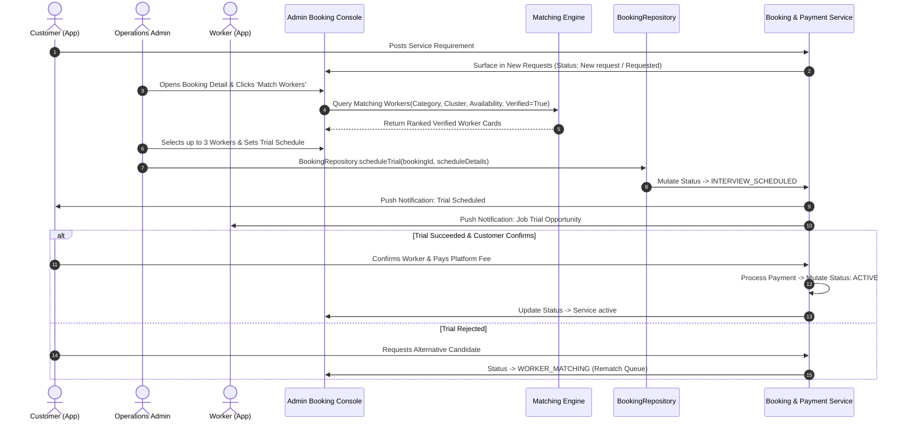

# SevaNest Admin Portal: Operations Admin Operational Specification & Workflows

> **Document Version:** 1.0.0  
> **Persona:** Operations Admin  
> **Status:** Authoritative Role Specification  
> **Source Documents:** *SevaNest PRD*, *SevaNest Admin Portal Frontend Architecture Document (v1.0)*, & *SevaNest Admin Portal Workflow and Frontend Development Plan*

---

## 1. Document Purpose and Role Responsibilities

### 1.1 Purpose
This document provides the authoritative, exhaustive operational and frontend specification for the **Operations Admin** persona in the SevaNest Web Admin & Operations Portal. It establishes all day-to-day marketplace workflows, customer booking orchestration, worker matching algorithms, interview/trial coordination, replacement management, refund processing, disciplinary actions, cross-role handoffs, and quality acceptance criteria.

### 1.2 Persona Definition & Responsibilities
The Operations Admin manages the continuous, high-throughput operations of the SevaNest household workforce marketplace. Key responsibilities include:
- **Marketplace Supply & Demand Triage:** Reviewing incoming customer booking requirements across service categories (House Maid, Driver, Cook, Babysitter, Elderly Care Helper, Cleaning Helper).
- **Candidate Worker Matching:** Operating the matching engine to pair customer requests with available, fully verified (`FULLY_VERIFIED`) domestic staff within geographic cluster zones (e.g., HITEC City, Madhapur, Kondapur, Gachibowli, Kukatpally).
- **Interview & Trial Coordination:** Scheduling telephonic or in-person trials, tracking attendance, and recording trial outcomes.
- **Booking Lifecycle Management:** Advancing bookings through server-permitted states from initial request to active service and contract completion.
- **Replacement Fulfillment:** Arbitrating replacement requests, validating coverage eligibility, rematching alternative workers, and chaining historical engagements.
- **Financial Oversight & Refunds:** Inspecting platform fee collections, monitoring payment statuses, and issuing audited refunds with mandatory operational notes.
- **Worker & Customer Account Governance:** Managing account states, adding operational notes, and executing account suspensions or blacklisting when warranted by policy.

---

## 2. Operations Admin Dashboard & Work Queues

### 2.1 Dashboard Overview
Upon authentication, the Operations Admin lands on the **Operations Console Dashboard**, optimized for rapid queue triage and single-action row execution.

```
+----------------------------------------------------------------------------------------------------+
| SEVANEST OPERATIONS CONSOLE (OPERATIONS ADMIN)                                                     |
+----------------------------------------------------------------------------------------------------+
| [ REAL-TIME OPERATIONAL METRIC CARDS ]                                                             |
| +--------------------+ +--------------------+ +--------------------+ +--------------------+       |
| | New Requests       | | Active Workforce   | | Replacement Queue  | | Open Disputes      |       |
| | Awaiting Match     | | Online / Available | | Pending Rematch    | | Escalated Tickets  |       |
| +--------------------+ +--------------------+ +--------------------+ +--------------------+       |
| +--------------------+ +--------------------+ +--------------------+ +--------------------+       |
| | Today's Trials     | | Active Engagements | | Pending Refunds    | | Police Verif Alert |       |
| | Scheduled Trials   | | Live Household Svc | | Under Review       | | Expiry Action Req  |       |
| +--------------------+ +--------------------+ +--------------------+ +--------------------+       |
+----------------------------------------------------------------------------------------------------+
| [ ACTION-ORIENTED OPERATIONAL WORK QUEUES ]                                                        |
| [Tab: New Booking Requests] [Tab: Replacement Requests] [Tab: Scheduled Trials] [Tab: Disputes]   |
| +------------------------------------------------------------------------------------------------+ |
| | Record ID  | Customer Name | Category   | Locality    | Current Status  | Dominant Quick Action| |
| |------------+---------------+------------+-------------+-----------------+----------------------| |
| | B-84920    | Anand Sharma  | Cook       | Kondapur    | New request     | [Match Workers]      | |
| | B-84912    | Priya Reddy   | House Maid | Gachibowli  | Replacement rev | [Rematch Candidate]  | |
| | B-84890    | Rajesh Kumar  | Driver     | Madhapur    | Interview set   | [Record Outcome]     | |
| +------------------------------------------------------------------------------------------------+ |
+----------------------------------------------------------------------------------------------------+
```

### 2.2 Operational Queue Definitions & UI States
1. **New Booking Requests Queue:** Displays incoming customer requests awaiting worker shortlisting and trial scheduling.
2. **Replacement Requests Queue:** Prioritizes active household service disruptions requiring urgent rematching.
3. **Scheduled Trials Queue:** Tracks interviews and trials requiring confirmation or post-trial customer follow-up.
4. **Presentation States:**
   - **Loading State:** Skeleton table rows and shimmer cards maintaining stable viewport heights.
   - **Data State:** Fast-rendering TanStack Table with URL-synchronized filtering, sorting, and pagination.
   - **Empty State:** Clean illustration with message: "All operational queues are clear."
   - **Error State:** Banner: "Failed to load operational queues. [Retry]" with automatic retry backoff.
   - **No-Access State:** Rendered if deep-linking into Super Admin configuration routes.

---

## 3. Permitted Modules and Navigation Structure

```
+---------------------------------------------------------------------------------------------------+
| OPERATIONS ADMIN SIDEBAR NAVIGATION                                                               |
+------------------+------------------------------+---------------------------+---------------------+
| SECTION          | MODULE / ROUTE               | PERMISSION KEY REQUIRED   | PERMITTED SCOPE     |
+------------------+------------------------------+---------------------------+---------------------+
| Operations       | Dashboard & Queues           | `dashboard.view`          | Full Manage         |
|                  | Verification Review          | `verification.review`     | Full Manage         |
|                  | Booking Pipeline             | `bookings.view`           | Full Manage         |
|                  | Support Tickets              | `support.view`            | View / Handoff      |
+------------------+------------------------------+---------------------------+---------------------+
| People           | Customers Directory          | `customers.view`          | Full Manage         |
|                  | Workers Directory            | `worker.view`             | Full Manage         |
|                  | Document Vault               | `documents.view_restricted`| Restricted View    |
|                  | Suspension & Blacklist       | `workers.manage_status`   | Full Manage         |
+------------------+------------------------------+---------------------------+---------------------+
| Money & Insight  | Transactions & Fees          | `payments.view`           | Full Manage         |
|                  | Refund Processing            | `refunds.manage`          | Full Manage         |
|                  | Reports & Analytics          | `reports.view`            | View Operations     |
|                  | Data Exports                 | `exports.generate`        | Full Manage         |
+------------------+------------------------------+---------------------------+---------------------+
| Control          | Configuration Masters        | `configuration.manage`    | NO ACCESS (Hidden)  |
|                  | Audit Trail Logs             | `audit.view`              | NO ACCESS (Hidden)  |
+------------------+------------------------------+---------------------------+---------------------+
```

---

## 4. Detailed Step-by-Step Module Workflows

### 4.1 Module: Booking Management Pipeline & Worker Matching

The booking pipeline is the core operational engine of the marketplace.



#### Step-by-Step Execution:
1. Navigate to `Operations > Booking Pipeline` (or click `New Requests` on Dashboard).
2. Click a booking record (Status: `New request`) to open the `BookingDetailDrawer`.
3. Review customer requirement specifications: Service Category (e.g., Cook), engagement shift (e.g., Morning 7:00 AM - 10:00 AM), locality cluster, family size, dietary preferences, and salary budget.
4. Click `Launch Matching Wizard`. The wizard queries verified worker inventory matching:
   - Verification State: `FULLY_VERIFIED` (Strict requirement; unverified workers are excluded).
   - Operational Status: `ACTIVE` and not currently committed to overlapping full-time engagements.
   - Geographic Coverage: Worker locality matches customer cluster or declared radius.
   - Skill Match: Worker possesses all mandatory category sub-skills.
5. Review candidate cards displaying photo thumbnail, experience years, customer rating average, languages spoken, and salary expectations.
6. Select candidate worker(s) and click `Coordinate Interview / Trial`.
7. Configure trial parameters: Proposed Trial Date, Start Time, Duration, and Customer Residential Address.
8. Enter internal matching notes.
9. Click `Confirm Trial Schedule`. The client dispatches `BookingRepository.scheduleTrial()` with an idempotency key.
10. The backend transitions booking status to `Interview set` (`Interview / trial scheduled`) and issues push notifications to Customer and Worker mobile apps.
11. Post-trial, if the customer confirms and completes the platform fee payment, the backend transitions the status to `Worker confirmed` -> `Service active` (`Active`).

---

### 4.2 Module: Replacement Management Workflow
When a customer requests a replacement for an active engagement, the Operations Admin coordinates rapid fulfillment.

```
+----------------------------------------------------------------------------------------------------+
| REPLACEMENT MANAGEMENT WORKSTATION                                                                 |
+----------------------------------------------------------------------------------------------------+
| Booking Ref: B-84912 | Category: House Maid | Active Worker: Sunita Devi (W-3819)                  |
| Customer: Priya Reddy (C-2091) | Locality: Gachibowli | Status: Replacement review                  |
+----------------------------------------------------------------------------------------------------+
| REPLACEMENT CASE DETAILS                                                                           |
| Stated Reason: Skill Mismatch / Inadequate Cleaning Quality                                        |
| Customer Notes: "Unable to manage deep kitchen cleaning as required."                             |
| Coverage Plan: Active Extended Replacement Coverage Plan (Verified Eligible)                       |
+----------------------------------------------------------------------------------------------------+
| REMATCHING CONSOLE                                                                                 |
| Action: [Search Alternative Verified Candidates in Gachibowli]                                     |
| Matched Candidate Selected: Lakshmi Bai (W-4012) - Maid / 8 Yrs Exp / Rating 4.9 (Verified)        |
| Trial Coordination: [Schedule Replacement Trial]                                                   |
| Operational Remarks (Mandatory): [ Replacement initiated under active policy coverage.           ] |
| Confirmation: [X] I confirm this replacement archives prior engagement and updates booking history |
| Action CTAs: [Reject Replacement]   [DISPATCH REPLACEMENT SHORTLIST]   [CONFIRM REPLACEMENT MATCH] |
+----------------------------------------------------------------------------------------------------+
```

#### Step-by-Step Execution:
1. Navigate to `Operations > Booking Pipeline` and select `Replacement Requests`.
2. Open a booking flagged `Replacement review` (`Replacement requested`).
3. Inspect replacement justification and verify that the booking is within the active replacement coverage period.
4. If eligible, set current engagement status to `REPLACEMENT_IN_PROGRESS`.
5. Click `Find Alternative Workers`. The system queries available verified workers in the customer's locality.
6. Shortlist alternative candidate workers.
7. Dispatch the candidate shortlist to the Customer App or coordinate a direct replacement trial.
8. Upon customer selection and successful trial, click `Confirm Replacement Match`.
9. The backend archives the prior worker engagement (preserving performance records and rating notes), chains the new worker to the active booking record, and transitions the status to `Service active`.

---

### 4.3 Module: Financial Oversight & Audited Refund Processing

The Operations Admin tracks platform collections and processes authorized customer refunds.

```
+----------------------------------------------------------------------------------------------------+
| AUDITED REFUND PROCESSING MODAL                                                                    |
+----------------------------------------------------------------------------------------------------+
| Transaction Reference: TXN-892104 | Original Amount: Rs. 1,500.00 | Status: Completed              |
| Customer: Anand Sharma (C-1092) | Associated Booking: B-8901 (Cancelled Post-Trial)                |
+----------------------------------------------------------------------------------------------------+
| REFUND CONFIGURATION                                                                               |
| Refund Scope:      (o) Full Refund (Rs. 1,500.00)     ( ) Partial Refund                           |
| Refund Amount:     [ Rs. 1,500.00                                                                ] |
| Reason Category:   [ Select Reason: Worker No-Show / Customer Cancellation / Unsatisfactory Trial v] |
| Operational Notes: [ Enter mandatory operational justification for finance audit records...      ] |
| Mutex / Key:       [ Auto-generated Client Mutex / Idempotency Key                               ] |
+----------------------------------------------------------------------------------------------------+
| [X] I confirm that this refund complies with SevaNest Commercial Cancellation Policies             |
|                                                                                                    |
| [ CANCEL ]                                                          [ CONFIRM & PROCESS REFUND ]   |
+----------------------------------------------------------------------------------------------------+
```

#### Step-by-Step Execution:
1. Navigate to `Money & Insight > Transactions`.
2. Filter transaction records by Status (`Paid` / `Failed` / `Refund pending`), Customer Name, or Booking Reference.
3. Select an eligible transaction associated with a cancelled trial or unresolved dispute.
4. Click `Process Refund` to open the `RefundProcessingModal`.
5. Select Refund Type: Full Refund or Partial Refund (enter specific numerical amount in INR).
6. Select a mandatory **Reason Category** from the dropdown: *Worker No-Show*, *Customer Cancellation Post-Trial*, *Unsatisfactory Service*, or *Operational Error*.
7. Enter detailed **Operational Notes** explaining the financial adjustment.
8. Verify that the client has generated a unique idempotency key.
9. Click `Confirm and Process Refund`.
10. The frontend dispatches `PaymentRepository.issueRefund()`. The backend initiates the refund via the payment gateway service, transitions transaction status to `Refund pending` -> `Refunded`, and writes a permanent audit entry.

---

### 4.4 Module: Customer & Worker Account Disciplinary Governance
The Operations Admin maintains platform integrity through account suspensions and blacklisting.

#### Worker Suspension / Blacklisting:
1. Navigate to `People > Workers Directory`.
2. Open the target worker profile.
3. Click `Administrative Actions > Suspend / Blacklist Worker`.
4. Select Action Type: `Temporary Suspension` or `Permanent Blacklist`.
5. Select a mandatory Disciplinary Category: *Misconduct*, *Chronic Unexcused Absence*, *Safety Breach*, *Fraudulent Documentation*.
6. Enter comprehensive **Operational Findings and Remarks**.
7. Check the confirmation checkbox: `I confirm this action complies with SevaNest Safety Guidelines`.
8. Click `Execute Status Mutation`.
9. The backend transitions the worker's status to `Suspended / Blacklisted`, terminates active job matching feeds, revokes worker mobile app access, and writes an audit log entry.

#### Customer Account Governance:
1. Navigate to `People > Customers Directory`.
2. Open customer profile and inspect booking history, payment ledger, and dispute tickets.
3. If non-payment or abusive conduct is established, click `Suspend Customer Account`.
4. Enter mandatory justification remarks and confirm.

---

## 5. Canonical Status Vocabulary & Label Mapping

The Operations Admin interface strictly utilizes canonical status mappings from Page 9 of the Frontend Architecture Document:

```
+----------------------------------------------------------------------------------------------------+
| CANONICAL STATUS LABEL MAPPING TABLE                                                               |
+--------------------------+---------------------------------+---------------------------+-----------+
| FUNCTIONAL DOMAIN        | BACKEND ENUM STATUS (EXAMPLES)  | ADMIN DISPLAY LABEL       | UI COLOR  |
+--------------------------+---------------------------------+---------------------------+-----------+
| Booking                  | `Requested`                     | New request               | Purple    |
| Booking                  | `Interview / trial scheduled`   | Interview set             | Blue      |
| Booking                  | `Confirmed`                     | Worker confirmed          | Green     |
| Booking                  | `Active`                        | Service active            | Dark Green|
| Booking                  | `Replacement requested`         | Replacement review        | Orange    |
| Payment                  | `Success` / `Failed`            | Paid / Payment failed     | Green/Red |
| Payment                  | `Refund pending`                | Refund pending            | Amber     |
| Worker                   | `Suspended` / `Blacklisted`     | Suspended / Blacklisted   | Red       |
| Verification             | `Pending` / `In review`         | Pending review / In review| Amber/Blue|
+----------------------------------------------------------------------------------------------------+
```

---

## 6. Information Boundaries, Data Visibility & Security

### 6.1 Information Access Rules
- **Customer & Worker PII:** Routine directory views display masked phone numbers and email addresses. Unmasking requires clicking `Reveal PII`, submitting a business reason, and generating an audit log entry.
- **Worker KYC Media:** Accessible via short-lived signed URLs in the restricted viewer; no direct public URLs.
- **Financial Data:** Full visibility into transaction amounts (INR), gateway references, and payment statuses. No access to raw payment card data or gateway secret keys.
- **Prohibited Modules:** 
  - Cannot access Configuration Masters (`Control > Categories / Areas / Fees / Roles`).
  - Cannot access the platform-wide Audit Trail Console (`Control > Audit Trail`).

### 6.2 Concurrent Operations & Optimistic Locking
- To support multiple Operations Admins working concurrently, every record mutation payload includes the entity's current version number.
- If a record was modified by another staff member, the server returns a `409 Conflict`, prompting the UI to display: *"This booking was updated by another administrator. Reloading latest data."*

---

## 7. Cross-Role Handoffs and Dependencies

```
+----------------------------------------------------------------------------------------------------+
| OPERATIONS ADMIN CROSS-ROLE HANDOFF MATRIX                                                         |
+------------------------+--------------------------+------------------------------------------------+
| OPERATIONAL SCENARIO   | SENDER / RECEIVER ROLE   | HANDOFF TRIGGER & INFORMATION PASSED           |
+------------------------+--------------------------+------------------------------------------------+
| Worker Activation      | From Verification Exec   | Worker completes all 6 KYC checks -> becomes   |
|                        | to Operations Admin      | available in Operations Matching Wizard roster.|
+------------------------+--------------------------+------------------------------------------------+
| Replacement Request    | From Support Executive   | Support triage identifies service failure ->   |
|                        | to Operations Admin      | Booking routed to Ops Replacement Queue.       |
+------------------------+--------------------------+------------------------------------------------+
| Customer Refund Claim  | From Support Executive   | Support confirms fee reimbursement grounds ->  |
|                        | to Operations Admin      | Refund task routed to Ops Refund Ledger.       |
+------------------------+--------------------------+------------------------------------------------+
| Pricing / Area Update  | From Operations Admin    | Ops reports supply shortage in cluster ->      |
|                        | to Super Admin           | Super Admin modifies pricing plan / geofence.  |
+------------------------+--------------------------+------------------------------------------------+
```

---

## 8. Acceptance Criteria & Manual Testing Checklist

### 8.1 Acceptance Criteria
- [ ] Matching Wizard excludes workers who are not `FULLY_VERIFIED` (all 6 checks approved).
- [ ] Scheduling a trial transitions booking status to `Interview set` and triggers notifications to both apps.
- [ ] Replacement workflow archives prior engagement data while retaining full audit history on the booking.
- [ ] Refund processing requires a mandatory reason category, operational notes, and an idempotency key.
- [ ] Worker suspension/blacklisting requires mandatory category tagging and notes, immediately revoking app access.
- [ ] Operations Admin is blocked from accessing Configuration Masters and Audit Trail routes.

### 8.2 Manual QA Testing Checklist
- [ ] **Test Case OA-01 (Worker Matching):** Open a `New request` booking, launch matching wizard, verify unverified workers are excluded, select a verified candidate, schedule trial, and verify status updates to `Interview set`.
- [ ] **Test Case OA-02 (Replacement Handoff):** Open a booking marked `Replacement review`, select alternative verified worker, confirm rematch, and verify historical engagement is archived and new engagement is chained.
- [ ] **Test Case OA-03 (Refund Processing):** Open a paid transaction, attempt refund without notes (verify blocked), select reason, enter notes, confirm refund, and verify transaction transitions to `Refund pending`.
- [ ] **Test Case OA-04 (Worker Blacklist):** Open worker profile, execute blacklist mutation with reason, and verify worker status updates to `Blacklisted` and cannot be matched to bookings.
- [ ] **Test Case OA-05 (Route Guards):** Attempt direct URL navigation to `/admin/configuration` and verify that the `NoAccessView` is displayed.

---

## 9. Open Decisions and Technical Risks

1. **Dual-Authorization on High-Value Refunds:** Commercial policy pending on whether refunds exceeding a specific threshold require secondary Super Admin approval.
2. **Two-Person Blacklisting Rule:** Operational policy pending on whether permanent blacklisting requires two-person verification.
3. **Automated Rematching Fallback:** Future enhancement consideration for automated candidate suggestions when a worker declines a trial.
