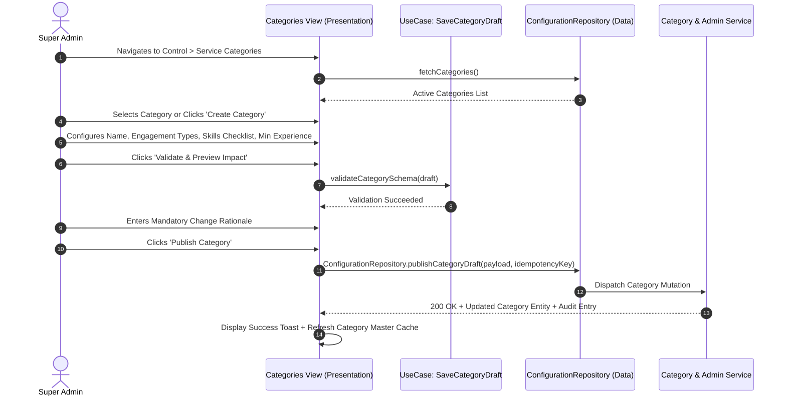
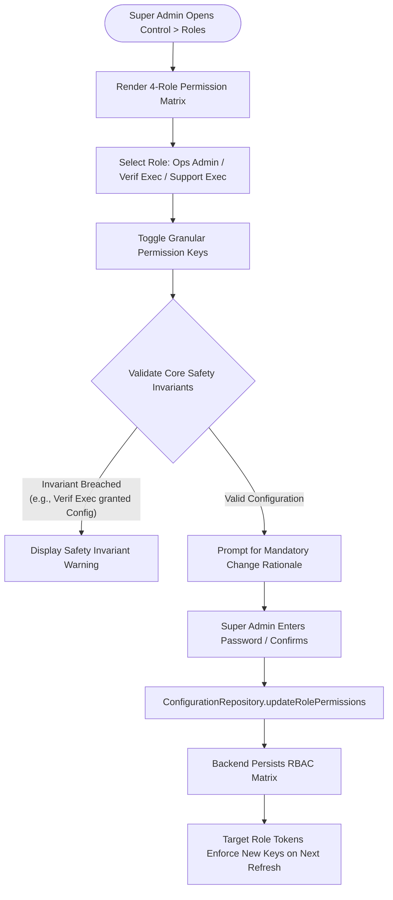

# SevaNest Admin Portal: Super Admin Operational Specification & Workflows

> **Document Version:** 1.0.0  
> **Persona:** Super Admin  
> **Status:** Authoritative Role Specification  
> **Source Documents:** *SevaNest PRD*, *SevaNest Admin Portal Frontend Architecture Document (v1.0)*, & *SevaNest Admin Portal Workflow and Frontend Development Plan*

---

## 1. Document Purpose and Role Responsibilities

### 1.1 Purpose
This document provides the definitive, comprehensive operational and frontend specification for the **Super Admin** persona in the SevaNest Web Admin & Operations Portal. It details all permitted capabilities, configuration masters management, pricing workflows, role-permission governance, audit trail inspection, data security controls, cross-role handoffs, and acceptance criteria.

### 1.2 Persona Definition & Responsibilities
The Super Admin is the executive platform administrator holding overarching system governance authority. Primary responsibilities include:
- **Platform Configuration Governance:** Defining and updating service categories, skill matrices, and minimum qualifications.
- **Geographic Operational Control:** Managing launch city parameters (Hyderabad V1) and active cluster boundaries (HITEC City, Madhapur, Kondapur, Gachibowli, Kukatpally).
- **Commercial & Revenue Management:** Maintaining dynamic fee schedules (one-time booking fees, monthly placement fees, customer subscriptions, extended replacement plans) without requiring application deployments or mobile app rebuilds.
- **Notification Template Authoring:** Configuring multi-channel message copy (Push Notifications, SMS, optional WhatsApp) with strict template variable validation.
- **RBAC Governance:** Maintaining administrative roles and assigning granular, server-evaluated permission keys.
- **Authoritative Audit Inspection:** Reviewing immutable platform audit logs for verification decisions, payment/refund events, account status mutations, PII reveals, and configuration changes.
- **Executive Business Oversight:** Analyzing high-level business intelligence, demand trends, conversion funnels, worker utilization, and platform collections.

---

## 2. Super Admin Dashboard & Executive Console

### 2.1 Dashboard Overview
Upon sign-in, the Super Admin lands on the **Executive Operations Dashboard**, which presents aggregated, server-calculated platform metrics and high-priority operational queues.

```
+----------------------------------------------------------------------------------------------------+
| SEVANEST EXECUTIVE DASHBOARD (SUPER ADMIN)                                                         |
+----------------------------------------------------------------------------------------------------+
| [ KPI METRIC CARDS - SERVER-REPORTED TOTALS & TRENDS ]                                             |
| +--------------------+ +--------------------+ +--------------------+ +--------------------+       |
| | Gross Bookings     | | Active Workforce   | | Verification Queue | | Active Grievances  |       |
| | Lifetime / Period  | | Verified & Online  | | Pending Ops Review | | Open / Escalated   |       |
| +--------------------+ +--------------------+ +--------------------+ +--------------------+       |
| +--------------------+ +--------------------+ +--------------------+ +--------------------+       |
| | Replacement Volume | | Platform Revenue   | | Scheduled Trials   | | Police Verif Due   |       |
| | Total Under Review | | Gross Collections  | | Active Trial Count | | Impending Expiry   |       |
| +--------------------+ +--------------------+ +--------------------+ +--------------------+       |
+----------------------------------------------------------------------------------------------------+
| [ SYSTEM QUEUE SUMMARIES ]                                                                         |
| - Pending Verification Applications: Direct link to Verification Review workstation                |
| - Escalated Support Tickets: Direct link to High-Priority Dispute resolution console               |
| - Active Replacement Requests: Direct link to Marketplace Rematching pipeline                      |
| - Impending Document Expirations: Direct link to Worker Re-Verification tracker                    |
+----------------------------------------------------------------------------------------------------+
```

### 2.2 Dashboard Presentation States
- **Loading State:** Skeleton KPI metric cards and placeholder panels matching layout dimensions.
- **Data State:** Interactive cards with period trend indicators and direct navigation links to underlying queues.
- **Empty State:** Neutral banner indicating zero active queue backlogs across the platform.
- **Error State:** Error banner displaying "Unable to load dashboard metrics. [Retry]" with automated exponential backoff retry.
- **No-Access State:** Not applicable to Super Admin (holds global manage privileges).

---

## 3. Permitted Modules and Navigation Structure

### 3.1 Sidebar Navigation Taxonomy
The Super Admin interface displays the complete, unrestricted administrative navigation hierarchy:

```
+---------------------------------------------------------------------------------------------------+
| SUPER ADMIN SIDEBAR NAVIGATION                                                                    |
+------------------+------------------------------+---------------------------+---------------------+
| SECTION          | MODULE / ROUTE               | PERMISSION KEY REQUIRED   | PERMITTED SCOPE     |
+------------------+------------------------------+---------------------------+---------------------+
| Operations       | Dashboard & Queues           | `dashboard.view`          | Full Manage / View  |
|                  | Verification Review          | `verification.review`     | Full Manage         |
|                  | Booking Pipeline             | `bookings.view`           | Full Manage         |
|                  | Support Tickets              | `support.view`            | Full Manage         |
+------------------+------------------------------+---------------------------+---------------------+
| People           | Customers Directory          | `customers.view`          | Full Manage         |
|                  | Workers Directory            | `worker.view`             | Full Manage         |
|                  | Document Vault               | `documents.view_restricted`| Restricted View    |
|                  | Suspension & Blacklist       | `workers.manage_status`   | Full Manage         |
+------------------+------------------------------+---------------------------+---------------------+
| Money & Insight  | Transactions & Fees          | `payments.view`           | Full Manage         |
|                  | Refund Processing            | `refunds.manage`          | Full Manage         |
|                  | Reports & Analytics          | `reports.view`            | Full Manage         |
|                  | Data Exports                 | `exports.generate`        | Full Manage         |
+------------------+------------------------------+---------------------------+---------------------+
| Control          | Service Categories & Areas   | `configuration.manage`    | Exclusive Manage    |
|                  | Fees, Plans & Templates      | `configuration.manage`    | Exclusive Manage    |
|                  | Roles & Permissions Matrix   | `roles.manage`            | Exclusive Manage    |
|                  | Audit Trail Console          | `audit.view`              | Exclusive View      |
+------------------+------------------------------+---------------------------+---------------------+
```

---

## 4. Detailed Step-by-Step Module Workflows

### 4.1 Module: Service Categories & Skill Masters Management
The Super Admin manages the domestic workforce service taxonomy without code changes.



#### Step-by-Step Execution:
1. Navigate to `Control > Service Categories`.
2. Inspect active categories: House Maid, Driver, Cook, Babysitter, Elderly Care Helper, Cleaning Helper.
3. To add or modify a category, open the **Category Editor Drawer**.
4. Configure required attributes:
   - Category Name, Display Tagline, and Semantic Icon identifier.
   - Allowed Engagement Types: Full-time, Part-time, Hourly, Daily, Live-in.
   - Structured Skills Taxonomy: Tag checklist items (e.g., Deep Cleaning, Infant Care, Continental Cooking).
   - Experience Thresholds: Minimum declared experience requirements.
5. Click `Validate & Preview`. The UI renders affected live listings and checks schema integrity.
6. Enter a mandatory **Change Rationale** in the confirmation dialog.
7. Click `Confirm and Publish`. The frontend dispatches `ConfigurationRepository.publishCategoryDraft()` with a unique idempotency key.
8. The backend commits changes, writes an audit log entry, and updates mobile app catalogs dynamically.

---

### 4.2 Module: Geographic Operational Areas & Geofences
1. Navigate to `Control > Operational Areas`.
2. View supported launch cities (Hyderabad V1) and active operational clusters: HITEC City, Madhapur, Kondapur, Gachibowli, Kukatpally.
3. Click `Add Operational Area` or edit an existing cluster boundary.
4. Define cluster metadata: Locality Name, Pin Codes covered, and Cluster Center coordinates.
5. Review the map boundary visualization powered by the Google Maps integration.
6. Enter mandatory **Operational Remarks** explaining the cluster adjustment.
7. Confirm and publish; the backend updates the matching service search radius.

---

### 4.3 Module: Commercial Pricing, Fees, and Subscription Plans
The Super Admin manages the platform's multi-revenue model parameters.

```
+----------------------------------------------------------------------------------------------------+
| EDIT FEES & COMMERCIAL PLANS WORKSPACE                                                             |
+----------------------------------------------------------------------------------------------------+
| Active Configuration Version: Live Baseline                                                        |
| Proposed Draft Workspace: In-Memory Draft                                                          |
|                                                                                                    |
| Fee / Plan Parameter              | Live Value          | Proposed Draft Value                     |
| ----------------------------------+---------------------+----------------------------------------- |
| Maid One-Time Booking Fee         | Current Value       | Modified Value                           |
| Driver Monthly Placement Fee      | Current Value       | Current Value (Unchanged)                 |
| Customer Monthly Subscription     | Current Value       | Modified Value                           |
| Extended Replacement Plan Fee     | Current Value       | Modified Value                           |
+----------------------------------------------------------------------------------------------------+
| GOVERNANCE VALIDATION & DIFF PREVIEW                                                               |
| Schema Bounds Check:              [PASSED - All numerical values are positive and within bounds]   |
| Change Rationale (Mandatory):     [ Enter detailed operational/commercial justification...       ] |
| Confirmation Checkbox:            [X] I confirm these pricing updates apply to new checkouts       |
| Action CTAs:                      [Discard Draft]   [View Full Diff]   [CONFIRM & PUBLISH FEES]    |
+----------------------------------------------------------------------------------------------------+
```

#### Step-by-Step Execution:
1. Navigate to `Control > Fees & Pricing Plans`.
2. Modify parameter fields across active revenue streams (Booking Fees, Placement Fees, Subscriptions, Replacement Extensions).
3. The schema validator enforces positive currency amounts and format constraints.
4. Click `View Diff Preview` to inspect the side-by-side comparison between active and proposed values.
5. Enter mandatory **Commercial Justification Remarks**.
6. Click `Confirm and Publish Fees`. The client attaches an idempotency key and dispatches `ConfigurationRepository.publishFeeSchedule()`.
7. The backend updates the pricing engine and logs a critical financial configuration audit event.

---

### 4.4 Module: Notification Templates Management
1. Navigate to `Control > Notification Templates`.
2. Select notification channel tab: `Push Notifications (FCM)`, `SMS`, or `WhatsApp`.
3. Select an event trigger template (e.g., `TRIAL_SCHEDULED`, `VERIFICATION_APPROVED`, `REPLACEMENT_SHORTLIST_SENT`).
4. Edit template body copy. The editor validates that all dynamic placeholders adhere to allowed system variables (e.g., `{{customer_name}}`, `{{worker_name}}`, `{{trial_time}}`).
5. Preview sample message rendering with mock variable data.
6. Enter mandatory **Template Revision Notes**.
7. Confirm and save; the backend updates the template registry in the Notification Service.

---

### 4.5 Module: Role & Permission Matrix Governance
The Super Admin dynamically configures access privileges for system personas.



#### Step-by-Step Execution:
1. Navigate to `Control > Roles & Permissions`.
2. Inspect the 4 standard administrative roles: Super Admin, Operations Admin, Verification Executive, Support Executive.
3. Select a role to modify its assigned permission keys.
4. Toggle specific functional capabilities (e.g., `refunds.manage`, `customers.reveal_pii`, `workers.manage_status`).
5. The system validates safety rules (e.g., Super Admin manage permissions cannot be disabled).
6. Enter mandatory **Security Authorization Notes**.
7. Confirm changes; the backend updates the role definition. Connected staff receive updated privileges upon their subsequent token refresh.

---

### 4.6 Module: Authoritative Audit Trail Inspection
The Super Admin has exclusive oversight of the platform's immutable audit log.

```
+----------------------------------------------------------------------------------------------------+
| CENTRALIZED AUDIT TRAIL CONSOLE                                                                    |
+----------------------------------------------------------------------------------------------------+
| Search Filters: [Actor Staff ID: ______] [Action Type: ALL v] [Target Record ID: ______] [Filter]  |
+----------------------------------------------------------------------------------------------------+
| Timestamp (IST)   | Actor           | Action Type         | Target Record | Change Summary / Notes |
|-------------------+-----------------+---------------------+---------------+------------------------|
| Chronological Log | Staff ID        | VERIF_APPROVE_DOC   | Worker ID     | Approved Aadhaar ID    |
| Chronological Log | Staff ID        | CONFIG_PUBLISH_FEES | Master ID     | Updated Booking Fee    |
| Chronological Log | Staff ID        | REFUND_PROCESSED    | Txn ID        | Issued Fee Refund      |
| Chronological Log | Staff ID        | WORKER_SUSPEND      | Worker ID     | Suspended: Misconduct  |
| Chronological Log | Staff ID        | PII_REVEAL_CONTACT  | Customer ID   | Revealed Phone: Ticket |
+----------------------------------------------------------------------------------------------------+
```

#### Step-by-Step Execution:
1. Navigate to `Control > Audit Trail`.
2. Apply indexed search criteria: Actor Staff ID, Action Type, Target Record ID, or IST Date/Time Range.
3. Click any row to open the `AuditDetailDrawer`.
4. Inspect the immutable change record:
   - Actor metadata: Staff ID, Role, Session IP.
   - Target entity: Record ID and Entity Type.
   - Pre-mutation state snapshot vs. Post-mutation state snapshot.
   - Mandatory operational remarks recorded by the actor.

---

### 4.7 Module: Business Reports & Analytics Oversight
1. Navigate to `Money & Insight > Reports`.
2. Select from the 12 PRD business report domains (Customer Acquisition, Worker Registrations, Verification Conversion, Demand by Category, Area Heatmaps, Utilization, Cancellations, Replacements, Payment Collections, Ticket SLA Resolution, Top-Rated Staff).
3. Select relative reporting periods and category filters.
4. Inspect responsive chart visualizations (Recharts/ECharts) and data tables.
5. For offline auditing, click `Generate Bulk Export`. The frontend requests an asynchronous export job via `ReportRepository.generateExport()`, which processes on the backend and delivers an audited download link.

---

## 5. Information Boundaries, Data Visibility & Security

### 5.1 Sensitive Data Visibility Rules
- **Customer & Worker PII:** Masked by default in routine views. The Super Admin can trigger the `Reveal PII` action by entering a mandatory business reason, which decrypts contact data for the active session and logs an audit record.
- **Worker KYC Documents:** Rendered strictly via short-lived signed URLs in an inline viewer with downloading disabled for routine operations.
- **Audit Logs:** Strictly read-only; no administrative mutation or deletion of audit logs is permitted under any circumstances.
- **Payment Instruments:** Gateway secrets and raw card numbers are never stored, transmitted, or accessible in the Admin Portal.

### 5.2 Session Management & Security Controls
- **In-Memory Token Storage:** JWT access tokens reside strictly in client memory (Zustand store).
- **Session Expiry Mid-Form:** Unsaved configuration drafts are cached in local memory during session re-authentication and replayed with an idempotency key upon sign-in.
- **Mandatory Rationale Enforcement:** The UI hard-blocks any configuration publish, role edit, account suspension, or refund issuance if the remarks text area is empty.

---

## 6. Cross-Role Handoffs and Operational Dependencies

```
+----------------------------------------------------------------------------------------------------+
| SUPER ADMIN OPERATIONAL HANDOFF MATRIX                                                             |
+------------------------+--------------------------+------------------------------------------------+
| SCENARIO / EVENT       | RECEIVING / DEPENDENT    | HANDOFF MECHANISM & INFORMATION PASSED         |
+------------------------+--------------------------+------------------------------------------------+
| New Category Published | Operations Admin         | New category appears in Matching Wizard;       |
|                        | & Mobile Apps            | customer apps can browse new service listings. |
+------------------------+--------------------------+------------------------------------------------+
| Pricing Plan Updated   | Payment Service          | New fee schedule applies to subsequent         |
|                        | & Operations Admin       | booking checkout and placement fee invoices.   |
+------------------------+--------------------------+------------------------------------------------+
| Role Permissions Edit  | All Staff Personas       | Updated permission array enforces new route    |
|                        |                          | and action gates on next token refresh.        |
+------------------------+--------------------------+------------------------------------------------+
| Critical Dispute       | Operations / Support     | Super Admin reviews audit log and provides     |
| Escalation             | Leadership               | authoritative arbitration on complex refunds.  |
+------------------------+--------------------------+------------------------------------------------+
```

---

## 7. Acceptance Criteria & Manual Testing Checklist

### 7.1 Acceptance Criteria
- [ ] Super Admin can access all platform modules without route-guard rejections.
- [ ] Category, Pricing, Area, Template, and Role edits strictly enforce the Draft -> Diff Preview -> Reason -> Publish lifecycle.
- [ ] Discarding a configuration draft completely clears uncommitted state without mutating live services.
- [ ] Publishing pricing changes requires a non-empty rationale and generates a permanent audit trail entry.
- [ ] Audit trail logs can be filtered across all six action categories with complete pagination fidelity.
- [ ] PII reveal actions prompt for mandatory justification and create a verified audit log record.

### 7.2 Manual QA Testing Checklist
- [ ] **Test Case SA-01 (Category Master):** Create a new service category draft, define sub-skills, verify schema validation, enter change reason, and publish. Verify new category appears in category lists.
- [ ] **Test Case SA-02 (Fee Schedule Update):** Edit booking fee, view side-by-side diff preview, attempt publish without reason (verify blocked), enter reason, and confirm publish. Verify updated fee applies.
- [ ] **Test Case SA-03 (Role Permissions):** Modify Operations Admin permissions, save changes with reason, and log in as Operations Admin to verify updated UI gates take effect.
- [ ] **Test Case SA-04 (Audit Inspection):** Execute a status mutation in another tab, open the Audit Trail console, filter by target ID, and verify the immutable change record and actor remarks.
- [ ] **Test Case SA-05 (Session Recovery):** Edit a fee draft, allow session to expire, trigger re-authentication modal, log in, and verify draft state is restored and successfully saved.

---

## 8. Open Decisions and Technical Risks

The following governance items remain classified as **Open Decisions** pending formal operational and legal sign-off:
1. **Admin Multi-Factor Authentication (MFA):** Product management to confirm if mandatory SMS/TOTP MFA is required for Super Admin sign-in in Version 1.
2. **Discretionary Financial Caps:** Final determination of whether Super Admin approval is mandatory for refunds exceeding a specified INR threshold.
3. **Data Purge Horizons:** Legal team to establish formal data retention schedules for historical audit logs and archived worker KYC records.
4. **Export Size Thresholds:** DevOps to establish maximum synchronous vs. asynchronous row limits for platform-wide report exports.
