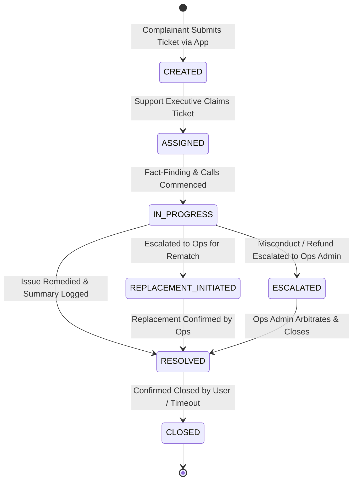

# SevaNest Admin Portal: Support Executive Operational Specification & Workflows

> **Document Version:** 1.0.0  
> **Persona:** Support Executive  
> **Status:** Authoritative Role Specification  
> **Source Documents:** *SevaNest PRD*, *SevaNest Admin Portal Frontend Architecture Document (v1.0)*, & *SevaNest Admin Portal Workflow and Frontend Development Plan*

---

## 1. Document Purpose and Role Responsibilities

### 1.1 Purpose
This document provides the authoritative, exhaustive operational and frontend specification for the **Support Executive** persona in the SevaNest Web Admin & Operations Portal. It governs the end-to-end customer and worker support lifecycle, grievance ticket triage, telephonic dispute investigation, real-time server-reported SLA tracking, case note logging, replacement handoffs, and disciplinary escalations.

### 1.2 Persona Definition & Responsibilities
The Support Executive is the frontline customer and worker care specialist responsible for maintaining service quality, resolving disputes, and upholding operational SLAs. Key responsibilities include:
- **Support Queue Triage:** Claiming incoming tickets logged by customers or domestic workers via mobile applications.
- **Dispute Investigation:** Reviewing complainant engagement histories, previous worker ratings, and booking context.
- **Telephonic Fact-Finding:** Contacting customers and workers to arbitrate service discrepancies, unannounced absences, or behavioral grievances.
- **SLA Deadline Compliance:** Monitoring live, server-calculated SLA countdowns to prevent breach escalations.
- **Internal Case Documentation:** Logging comprehensive, immutable internal case notes for operational visibility.
- **Operational Handoffs:** Escalating replacement requests and customer refund claims to Operations Admins for execution.

---

## 2. Support Executive Dashboard & Ticket Queues

### 2.1 Dashboard Overview
Upon sign-in, the Support Executive lands on the **Support Operations Console**, prioritized by ticket urgency and impending SLA deadlines.

```
+----------------------------------------------------------------------------------------------------+
| SEVANEST SUPPORT CONSOLE (SUPPORT EXECUTIVE)                                                       |
+----------------------------------------------------------------------------------------------------+
| [ REAL-TIME SUPPORT KPI CARDS ]                                                                    |
| +--------------------+ +--------------------+ +--------------------+ +--------------------+       |
| | Open Grievances    | | Assigned to Me     | | SLA At Risk        | | Resolved Today     |       |
| | Unassigned Queue   | | Active Cases       | | Impending Breach   | | Completed Tickets  |       |
| +--------------------+ +--------------------+ +--------------------+ +--------------------+       |
+----------------------------------------------------------------------------------------------------+
| [ ACTIONABLE SUPPORT TICKET QUEUES ]                                                               |
| [Tab: Unassigned Queue] [Tab: My Active Cases] [Tab: SLA At Risk (<25% Left)] [Tab: Escalated]     |
| +------------------------------------------------------------------------------------------------+ |
| | Ticket ID | Complainant   | Role/Category | Dispute Category   | SLA Indicator   | Primary CTA | |
| |-----------+---------------+---------------+--------------------+-----------------+-------------| |
| | TKT-4921  | Rajesh Kumar  | Customer/Maid | ATTENDANCE_BREACH  | SLA At Risk     | [Open Case] | |
| | TKT-4918  | Sunita Devi   | Worker/Maid   | PAYMENT_QUERY      | Normal (>50%)   | [Open Case] | |
| | TKT-4910  | Priya Reddy   | Customer/Cook | SERVICE_QUALITY    | Escalated/Breach| [Open Case] | |
| +------------------------------------------------------------------------------------------------+ |
+----------------------------------------------------------------------------------------------------+
```

### 2.2 Presentation States
- **Loading State:** Skeleton table rows with simulated badge and SLA chip placeholders.
- **Data State:** High-density, filterable table with real-time countdown chips and quick-assign buttons.
- **Empty State:** Clean illustration with message: *"All support queues are clear. Zero unresolved grievance tickets."*
- **Error State:** Banner displaying *"Failed to load support tickets. [Retry]"* with automated retry.
- **No-Access State:** Rendered if the user attempts to access restricted modules (Payments, Verification, Configuration).

---

## 3. Permitted Modules and Navigation Structure

```
+---------------------------------------------------------------------------------------------------+
| SUPPORT EXECUTIVE SIDEBAR NAVIGATION                                                              |
+------------------+------------------------------+---------------------------+---------------------+
| SECTION          | MODULE / ROUTE               | PERMISSION KEY REQUIRED   | PERMITTED SCOPE     |
+------------------+------------------------------+---------------------------+---------------------+
| Operations       | Support Dashboard            | `dashboard.view`          | View Queue Metrics  |
|                  | Support Tickets Console      | `support.view`            | Full Manage         |
|                  | Booking Pipeline             | `bookings.view`           | View Context Only   |
|                  | Verification Review          | `verification.review`     | NO ACCESS (Hidden)  |
+------------------+------------------------------+---------------------------+---------------------+
| People           | Customers Directory          | `customers.view`          | View Context Only   |
|                  | Workers Directory            | `worker.view`             | View Context Only   |
|                  | Document Vault               | `documents.view_restricted`| NO ACCESS (Hidden) |
|                  | Suspension & Blacklist       | `workers.manage_status`   | NO ACCESS (Hidden)  |
+------------------+------------------------------+---------------------------+---------------------+
| Money & Control  | Payments / Reports / Master  | Multiple Keys             | NO ACCESS (Hidden)  |
+------------------+------------------------------+---------------------------+---------------------+
```

---

## 4. Detailed Step-by-Step Ticket Workflows

### 4.1 Ticket Lifecycle State Machine & SLA Model



### 4.2 Server-Reported SLA Tracking Model
All SLA countdowns, elapsed durations, and breach states are computed by the backend service. The frontend renders real-time visual indicator chips:
- **Normal Status (Green Badge):** > 50% of resolution SLA window remaining.
- **At Risk Status (Amber Badge):** < 25% of resolution SLA window remaining.
- **Escalated / SLA Breached Status (Red Badge):** SLA deadline exceeded; automatically surfaces in Operations Admin priority queue.

---

### 4.3 Detailed Step-by-Step Ticket Resolution Workstation

```
+----------------------------------------------------------------------------------------------------+
| SUPPORT TICKET CONSOLE: TKT-4921                                                                   |
| Status: In progress | Priority: HIGH | SLA Status: At Risk | Assigned: Support Exec Staff ID       |
+----------------------------------------------------------------------------------------------------+
| [COMPLAINANT & CASE METADATA]                                                                      |
| Complainant: Rajesh Kumar (C-4812) | Subject Worker: Sunita Devi (W-3819) | Category: House Maid   |
| Linked Booking: B-7712 (Active Service) | Grievance Category: ATTENDANCE_BREACH                    |
| Description: "Worker did not arrive for morning shift; phone unreachable."                         |
+----------------------------------------------------------------------------------------------------+
| TICKET CHRONOLOGICAL TIMELINE & CASE NOTES                                                         |
| -------------------------------------------------------------------------------------------------- |
| [Event 1 / Ticket Opened] Grievance logged by customer via mobile app. SLA countdown started.      |
| [Event 2 / Assignment]    Assigned to Support Executive Staff ID. Status -> Assigned.              |
| [Event 3 / Call Logged]   Staff Dialed Worker: Phone switched off. Dialed emergency contact.       |
| [Event 4 / Investigation] Emergency contact states worker had family medical emergency.           |
+----------------------------------------------------------------------------------------------------+
| EXECUTIVE ACTION CONSOLE                                                                           |
| Add Internal Case Note:   [ Worker unreachable due to family emergency. Reached out to customer. ]|
| Update Case Status:       [ In progress -> Resolved / Escalated / Replacement Handoff            v] |
| Primary Action CTAs:                                                                               |
| [PATH A: MARK RESOLVED]   [PATH B: REQUEST REPLACEMENT (HANDOFF)]   [PATH C: ESCALATE TO OPS ADMIN]|
+----------------------------------------------------------------------------------------------------+
```

#### Step-by-Step Execution:
1. Navigate to `Operations > Support Tickets`.
2. Select an unassigned ticket from the queue (Status: `Created`) and click `Claim Ticket`. The status transitions to `Assigned`.
3. Open the `TicketDetailConsole` to inspect the case context:
   - Complainant profile, category, and past ticket history.
   - Linked booking reference, start date, and service shift.
   - Subject worker profile, historical ratings, and previous complaints.
4. Conduct telephonic investigation with both parties.
5. Click `Add Internal Case Note` to record telephonic findings and operational observations.
6. Select the appropriate resolution path:

#### Path A: Standard Resolution
- If the issue is resolved via mediation (e.g., worker arrives late with customer consent), enter the **Resolution Summary**.
- Click `Mark as Resolved`. The status transitions to `Resolved`, and the backend sends a resolution notification to the complainant.

#### Path B: Replacement Handoff
- If the customer requests worker replacement due to attendance or quality failure:
- Click `Initiate Replacement Request`.
- Select the replacement justification category.
- Enter detailed operational notes.
- Confirm handoff; the ticket status links to the booking, flagging it as `Replacement review` in the Operations Admin queue.

#### Path C: Disciplinary or Financial Escalation
- If severe worker misconduct, theft, or a customer refund claim is established:
- Click `Escalate to Operations Admin`.
- Select the escalation reason (*Severe Misconduct*, *Safety Breach*, *Refund Claim*).
- Enter mandatory **Escalation Case Notes**.
- Confirm escalation; the status updates to `Escalated` (`Escalated / SLA breached`), routing the case to the Operations Admin priority dashboard.

---

## 5. Canonical Status Vocabulary & Label Mapping

The Support Executive interface strictly utilizes canonical status mappings from Page 9 of the Frontend Architecture Document:

```
+----------------------------------------------------------------------------------------------------+
| SUPPORT & DISPUTE STATUS LABEL MAPPING                                                             |
+--------------------------+---------------------------------+---------------------------+-----------+
| DOMAIN AREA              | BACKEND ENUM STATUS             | ADMIN DISPLAY LABEL       | UI BADGE  |
+--------------------------+---------------------------------+---------------------------+-----------+
| Support Ticket           | `Created`                       | Created                   | Neutral   |
| Support Ticket           | `Assigned`                      | Assigned                  | Blue      |
| Support Ticket           | `In progress`                   | In progress               | Blue Dark |
| Support Ticket           | `Escalated` / `SLA breached`    | Escalated / SLA breached  | Red Urgent|
| Support Ticket           | `Resolved`                      | Resolved                  | Green     |
| Support Ticket           | `Closed`                        | Closed                    | Slate     |
| Booking (Read-Only)      | `Active`                        | Service active            | Green Dark|
| Booking (Read-Only)      | `Replacement requested`         | Replacement review        | Orange    |
+----------------------------------------------------------------------------------------------------+
```

---

## 6. Information Boundaries, Data Visibility & Security

### 6.1 Information Access Rules
- **Customer & Worker PII:** Phone numbers and email addresses are masked by default. If telephonic contact is required to investigate a ticket, clicking `Reveal Contact` prompts for justification and logs an audit entry.
- **Read-Only Context:** Can view customer booking histories, worker rating averages, and previous tickets to evaluate chronic dispute trends.
- **Prohibited Financial Actions:** 
  - **Zero Direct Refund Authority:** The Support Executive is strictly blocked from executing refunds. All refund claims must be escalated to the Operations Admin.
- **Prohibited Disciplinary Actions:**
  - **Zero Disciplinary Authority:** The Support Executive cannot suspend or blacklist workers directly. Disciplinary incidents must be escalated with evidence notes.
- **Prohibited Modules:** Zero access to KYC Document Vaults, Configuration Masters, and Audit Trail logs.

---

## 7. Cross-Role Handoffs and Dependencies

```
+----------------------------------------------------------------------------------------------------+
| SUPPORT EXECUTIVE CROSS-ROLE HANDOFF MATRIX                                                        |
+------------------------+--------------------------+------------------------------------------------+
| OPERATIONAL SCENARIO   | RECEIVING ROLE           | HANDOFF MECHANISM & INFORMATION PASSED         |
+------------------------+--------------------------+------------------------------------------------+
| Replacement Warranted  | Operations Admin         | Ticket flagged for replacement -> booking      |
|                        | (Marketplace Rematch)    | surfaces in Operations Rematching Queue.       |
+------------------------+--------------------------+------------------------------------------------+
| Refund Claim           | Operations Admin         | Grievance warrants fee reimbursement ->        |
|                        | (Financial Ledger)       | Refund task routed to Operations Refund Queue. |
+------------------------+--------------------------+------------------------------------------------+
| Severe Misconduct /    | Operations Admin /       | Worker misconduct or safety breach -> case     |
| Safety Violation       | Super Admin              | escalated for disciplinary suspension review.  |
+------------------------+--------------------------+------------------------------------------------+
```

---

## 8. Acceptance Criteria & Manual Testing Checklist

### 8.1 Acceptance Criteria
- [ ] Support tickets display live, server-reported SLA countdown chips with visual urgency colors.
- [ ] Claiming a ticket updates status to `Assigned` with the executive's Staff ID.
- [ ] Adding case notes creates an immutable, timestamped record in the ticket timeline.
- [ ] Initiating a replacement transitions the linked booking to `Replacement review` in the Operations queue.
- [ ] Support Executive is hard-blocked from issuing refunds or executing worker suspensions.
- [ ] Support Executive cannot access Verification queues, Configuration Masters, or Audit Logs.

### 8.2 Manual QA Testing Checklist
- [ ] **Test Case SE-01 (Ticket Claim):** Open unassigned queue, claim a ticket, and verify status transitions to `Assigned` and appears in `My Active Cases`.
- [ ] **Test Case SE-02 (Case Note Logging):** Add a telephonic investigation note, save, and verify note appears in timeline with author Staff ID.
- [ ] **Test Case SE-03 (Standard Resolution):** Enter resolution summary, click `Mark as Resolved`, and verify status updates to `Resolved`.
- [ ] **Test Case SE-04 (Replacement Handoff):** Click `Request Replacement`, enter justification, confirm handoff, and verify associated booking transitions to `Replacement review`.
- [ ] **Test Case SE-05 (Privilege Boundary Check):** Verify that no `Issue Refund` or `Blacklist Worker` buttons exist in the Support Executive console.

---

## 9. Open Decisions and Technical Risks

1. **In-App Telephony / Call Masking:** Phase 2 consideration for integrating VoIP call masking within the ticket console to prevent direct number exposure.
2. **Automated Ticket Routing Rules:** Operational rules pending regarding auto-assigning incoming tickets based on executive workload vs. manual queue claiming.
3. **Customer Re-Open Horizon:** Policy definition on time window allowing customers to re-open a resolved ticket before permanent closure.
