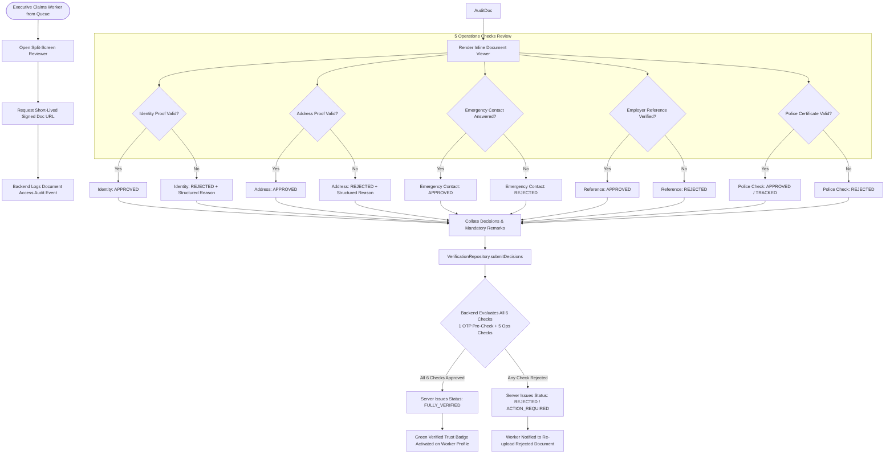

# SevaNest Admin Portal: Verification Executive Operational Specification & Workflows

> **Document Version:** 1.0.0  
> **Persona:** Verification Executive  
> **Status:** Authoritative Role Specification  
> **Source Documents:** *SevaNest PRD*, *SevaNest Admin Portal Frontend Architecture Document (v1.0)*, & *SevaNest Admin Portal Workflow and Frontend Development Plan*

---

## 1. Document Purpose and Role Responsibilities

### 1.1 Purpose
This document provides the authoritative, comprehensive operational and frontend specification for the **Verification Executive** persona in the SevaNest Web Admin & Operations Portal. It details the end-to-end worker KYC verification lifecycle, the split-screen document inspection workstation, the distinction between automated onboarding pre-checks and operations-reviewed trust checks, mandatory rejection remarks, signed document URL security, re-verification monitoring, cross-role handoffs, and quality acceptance criteria.

### 1.2 Persona Definition & Responsibilities
The Verification Executive is the dedicated Trust & Safety specialist responsible for upholding SevaNest's core brand promise: **"Verified Help. Trusted Homes."** Primary responsibilities include:
- **KYC Queue Triage:** Processing incoming worker onboarding applications ordered oldest-first.
- **Document Authentication:** Inspecting uploaded government identity proofs and address documents for clarity, authenticity, and metadata consistency.
- **Telephonic Reference & Emergency Vetting:** Conducting direct telephonic verification calls with declared emergency contacts and previous domestic employers.
- **Police Clearance Tracking:** Inspecting uploaded police verification certificates and tracking background verification statuses.
- **Structured Check Decisioning:** Recording granular `Approved` or `Rejected` decisions per check, accompanied by structured rejection categories and mandatory remarks.
- **Expiry & Re-Check Administration:** Monitoring upcoming document expirations and issuing re-verification requests to active workers.

---

## 2. Verification Executive Dashboard & Work Queues

### 2.1 Dashboard Overview
Upon logging in, the Verification Executive is presented with the **Trust & Verification Queue Dashboard**, designed specifically for high-throughput vetting workflows.

```
+----------------------------------------------------------------------------------------------------+
| SEVANEST TRUST & VERIFICATION CONSOLE (VERIFICATION EXECUTIVE)                                     |
+----------------------------------------------------------------------------------------------------+
| [ VERIFICATION QUEUE METRIC CARDS ]                                                                |
| +--------------------+ +--------------------+ +--------------------+ +--------------------+       |
| | Pending Review     | | In-Progress Review | | Re-Check Due       | | Today's Decisions  |       |
| | Awaiting Review    | | Claimed / Active   | | Impending Expiry   | | Processed Count    |       |
| +--------------------+ +--------------------+ +--------------------+ +--------------------+       |
+----------------------------------------------------------------------------------------------------+
| [ OPERATIONAL VERIFICATION QUEUES ]                                                                |
| [Tab: Pending Review (Oldest First)] [Tab: In-Review Workstation] [Tab: Re-Check Due / Expired]     |
| +------------------------------------------------------------------------------------------------+ |
| | Worker ID | Worker Name    | Category   | Submission Time | Pending Check Types | Primary CTA  | |
| |-----------+----------------+------------+-----------------+---------------------+--------------| |
| | W-10892   | Ramesh Kumar   | Driver     | Recent Queue    | ID, Address, Police | [Review KYC] | |
| | W-10890   | Sunita M       | House Maid | Recent Queue    | References, Emer Cont| [Review KYC] | |
| | W-10884   | Lakshmi Bai    | Cook       | Recent Queue    | Address Re-upload   | [Review KYC] | |
| +------------------------------------------------------------------------------------------------+ |
+----------------------------------------------------------------------------------------------------+
```

### 2.2 Presentation States
- **Loading State:** Skeleton table rows with placeholder badges representing check types.
- **Data State:** Fast-sorting queue sorted oldest-first with quick-claim action buttons.
- **Empty State:** Neutral illustration with the message: *"All verification queues are up to date. No pending worker documents awaiting review."*
- **Error State:** Banner displaying *"Failed to load verification queue. [Retry]"* with automated retry.
- **No-Access State:** Rendered if the user attempts to access unauthorized modules (Bookings, Customers, Payments, Configuration).

---

## 3. Permitted Modules and Navigation Structure

```
+---------------------------------------------------------------------------------------------------+
| VERIFICATION EXECUTIVE SIDEBAR NAVIGATION                                                         |
+------------------+------------------------------+---------------------------+---------------------+
| SECTION          | MODULE / ROUTE               | PERMISSION KEY REQUIRED   | PERMITTED SCOPE     |
+------------------+------------------------------+---------------------------+---------------------+
| Operations       | Verification Dashboard       | `dashboard.view`          | View Queue Metrics  |
|                  | Verification Review          | `verification.review`     | Full Manage         |
|                  | Booking Pipeline             | `bookings.view`           | NO ACCESS (Hidden)  |
|                  | Support Tickets              | `support.view`            | NO ACCESS (Hidden)  |
+------------------+------------------------------+---------------------------+---------------------+
| People           | Customers Directory          | `customers.view`          | NO ACCESS (Hidden)  |
|                  | Workers Directory            | `worker.view`             | View Only (Context) |
|                  | Document Vault               | `documents.view_restricted`| Full Manage Review |
|                  | Suspension & Blacklist       | `workers.manage_status`   | NO ACCESS (Hidden)  |
+------------------+------------------------------+---------------------------+---------------------+
| Money & Control  | Payments / Reports / Master  | Multiple Keys             | NO ACCESS (Hidden)  |
+------------------+------------------------------+---------------------------+---------------------+
```

---

## 4. Multi-Tier Verification Structure & Inspection Workflow

### 4.1 Verification Architecture: 1 Pre-Check + 5 Operations Checks
Verification in SevaNest is partitioned into two distinct tiers:
1. **Automated Onboarding Pre-Check:** Telecom mobile OTP verification completed during worker registration.
2. **Operations-Reviewed Trust Checks (5 Discrete Checks):** Mandatory checks evaluated directly by the Verification Executive.

```
+----------------------------------------------------------------------------------------------------+
| 6-TIER WORKER VERIFICATION CHECKLIST STRUCTURE                                                     |
+--------------------------+------------------------------+----------------------------+-------------+
| CHECK TIER & TYPE        | VERIFICATION SOURCE DATA     | EVALUATION METHODOLOGY     | ACTOR       |
+--------------------------+------------------------------+----------------------------+-------------+
| [Pre-Check] Mobile OTP   | Telecom SMS Gateway OTP      | Automated System Check     | System / App|
| [Check 1] Identity Check | Aadhaar / Voter ID / Passport| Visual Document Inspection | Verif. Exec |
| [Check 2] Address Check  | Utility Bill / Rent Agreement| Address Proof Inspection   | Verif. Exec |
| [Check 3] Emergency Cont.| Family Contact Details       | Telephonic Call Vetting    | Verif. Exec |
| [Check 4] Employment Ref | Previous Employer Details    | Telephonic Reference Call  | Verif. Exec |
| [Check 5] Police Verif.  | Police Clearance Certificate | Certificate Review/Tracking| Verif. Exec |
+--------------------------+------------------------------+----------------------------+-------------+
```

---

### 4.2 Split-Screen KYC Review Workstation

The Verification Executive operates within a dedicated split-screen review console.

```
+----------------------------------------------------------------------------------------------------+
| SPLIT-SCREEN VERIFICATION REVIEW WORKSTATION: WORKER W-10482 (Lakshmi Devi)                        |
+----------------------------------------------------------------------------------------------------+
| [LEFT PANE: WORKER PROFILE & CHECKLIST]        | [RIGHT PANE: SECURE DOCUMENT VIEWER]              |
| Name: Lakshmi Devi | Primary Role: House Maid  | Document: Government Identity (Aadhaar Card Front)|
| Locality: Madhapur | Status: Pending review    | Security: Short-lived Signed URL (Expires Soon)   |
| ---------------------------------------------- | ------------------------------------------------- |
| CHECKLIST EVALUATION:                          | +-----------------------------------------------+ |
| 1. Mobile OTP Check:   [PASSED - System OTP]   | |                                               | |
|                                                | |      [ SECURE EMBEDDED DOCUMENT VIEWER ]      | |
| 2. Identity Check (Aadhaar):                   | |        (Aadhaar Card Image Preview)           | |
|    Status: (o) Approved  ( ) Rejected          | |                                               | |
|    Doc No: [ XXXX-XXXX-1234 (Verified Match) ] | |  Name on Doc: Lakshmi Devi                    | |
|                                                | |  DOB on Doc: Verified Match                   | |
| 3. Address Proof Check (Electricity Bill):     | |  Photo Clarity: Clear & Unobstructed          | |
|    Status: (o) Approved  ( ) Rejected          | |                                               | |
|                                                | +-----------------------------------------------+ |
| 4. Emergency Contact Check:                    | [ Rotate View ]   [ Zoom In / Out ]   [ Full Screen ]|
|    Contact: Husband - Verified via Phone Call  | ------------------------------------------------- |
|    Status: (o) Approved  ( ) Rejected          | NEXT DOCUMENT IN QUEUE:                           |
|                                                | [ View Address Proof ] [ View Police Certificate ]|
| 5. Previous Employer Reference Check:          | ------------------------------------------------- |
|    Reference: Contacted Mrs. S. Rao (Positive) | REJECTION REMARKS (Mandatory if any check Failed) |
|    Status: (o) Approved  ( ) Rejected          | Category: [ Select Rejection Reason Category   v] |
|                                                | Notes:    [ Enter detailed check-level notes... ] |
| 6. Police Clearance Certificate Check:         | ------------------------------------------------- |
|    Status: [TRACKED - Certificate Valid]       | [ CANCEL ]             [ SUBMIT CHECK DECISIONS ] |
+----------------------------------------------------------------------------------------------------+
```

---

### 4.3 Detailed Step-by-Step Review Pipeline



#### Step-by-Step Execution:
1. Navigate to `Operations > Verification Review` and select a worker record from `Pending Review`.
2. Click `Claim & Start Review`. The worker status updates to `In review`.
3. The left panel loads the candidate's profile data and the 6-tier verification checklist.
4. The right panel initializes the **Secure Document Viewer**. The client calls `VerificationRepository.getSignedDocumentUrl(docId)` to fetch a temporary, time-bounded link.
5. **Inspect Identity Proof:**
   - Cross-check worker name, photo clarity, and date of birth against profile metadata.
   - If valid, mark `Approved`. If invalid, mark `Rejected` and select a reason category (*Blurry Image*, *Name Mismatch*, *Tampered Document*, *Expired ID*).
6. **Inspect Address Proof:**
   - Inspect utility bill or rent agreement locality against declared operational area.
   - Mark `Approved` or `Rejected` with notes.
7. **Perform Emergency Contact Vetting:**
   - Dial the declared emergency contact number. Confirm relationship and residential address.
   - Record call summary and mark `Approved` or `Rejected`.
8. **Perform Previous Employer Reference Call:**
   - Dial previous household employer. Verify employment tenure, role, and conduct.
   - Record reference feedback notes and mark `Approved` or `Rejected`.
9. **Inspect Police Clearance Certificate:**
   - Review certificate legitimacy, seal, and validity, or record external tracking reference.
10. If any check is marked `Rejected`, the UI mandates entering explanatory text in the **Operational Remarks** field.
11. Click `Submit Verification Decisions`.
12. The client attaches an idempotency key and dispatches `VerificationRepository.submitDecisions()`.
13. The backend evaluates the composite status:
    - If all 6 checks are approved -> Worker status becomes `FULLY_VERIFIED` (`Active`) and the green trust badge is rendered.
    - If any check is rejected -> Worker status becomes `ACTION_REQUIRED` or `REJECTED`, and the worker app is prompted for re-upload.

---

### 4.4 Module: Expiry & Re-Verification Administration
1. Navigate to `Operations > Verification Review` and click `Re-Check Due`.
2. Review active workers whose annual address proofs or police verification records are nearing expiration.
3. Select worker and click `Initiate Re-Verification Request`.
4. Enter re-verification instructions (e.g., *"Please upload updated electricity bill for annual re-check"*).
5. The backend dispatches an automated push notification to the Worker App.
6. When the worker re-uploads documents, the record is placed back into the `Pending Review` queue.

---

## 5. Canonical Status Vocabulary & Label Mapping

The Verification Executive interface adheres to the canonical status mapping defined in Page 9 of the Frontend Architecture Document:

```
+----------------------------------------------------------------------------------------------------+
| VERIFICATION DOMAIN STATUS LABEL MAPPING                                                           |
+--------------------------+---------------------------------+---------------------------+-----------+
| DOMAIN AREA              | BACKEND ENUM STATUS             | ADMIN DISPLAY LABEL       | UI BADGE  |
+--------------------------+---------------------------------+---------------------------+-----------+
| Verification             | `Pending`                       | Pending review            | Amber     |
| Verification             | `In review`                     | In review                 | Blue      |
| Verification             | `Approved`                      | Approved                  | Green     |
| Verification             | `Rejected`                      | Rejected                  | Red       |
| Verification             | `Expiry due`                    | Re-check due              | Orange    |
| Worker                   | `Active` (All 6 Checks Passed)  | Verified Worker (Badge)   | Green Dark|
| Worker                   | `Suspended` / `Blacklisted`     | Suspended / Blacklisted   | Red Solid |
+----------------------------------------------------------------------------------------------------+
```

---

## 6. Information Boundaries, Document Access & Privacy Controls

### 6.1 Strict Document Privacy Protocols
- **Temporary Signed URLs:** Documents are never accessed via static or public URLs. Each document inspection requests a short-lived signed link expiring quickly.
- **Audited Document Access:** Every single document view event automatically dispatches an audit log record containing the executive's Staff ID, Worker ID, Document ID, and timestamp.
- **Print / Download Prevention:** The inline document viewer disables browser context menus, printing triggers, and direct file downloads.
- **Masked Data in Routine Lists:** Aadhaar numbers are masked (`XXXX-XXXX-1234`) across all list views.

### 6.2 Prohibited Actions
- **Must Not Assign Workers:** The Verification Executive cannot match workers to bookings or schedule customer trials.
- **Must Not Access Customer Data:** Zero access to customer profiles, addresses, or booking requirements.
- **Must Not Overwrite Verification State:** The frontend is strictly prohibited from displaying a "Verified" badge until the server confirms all 6 checks are approved.
- **Must Not Edit Configuration:** Zero access to platform masters or fee configuration.

---

## 7. Cross-Role Handoffs and Dependencies

```
+----------------------------------------------------------------------------------------------------+
| VERIFICATION EXECUTIVE CROSS-ROLE HANDOFF MATRIX                                                   |
+------------------------+--------------------------+------------------------------------------------+
| OPERATIONAL SCENARIO   | RECEIVING ROLE           | HANDOFF MECHANISM & INFORMATION PASSED         |
+------------------------+--------------------------+------------------------------------------------+
| Worker Verified        | Operations Admin         | Worker completes all 6 checks -> status        |
| (Activation)           | (Marketplace Matching)   | becomes FULLY_VERIFIED; worker appears in Ops  |
|                        |                          | Matching Wizard candidate inventory.           |
+------------------------+--------------------------+------------------------------------------------+
| Document Fraud /       | Operations Admin /       | Executive flags forged identity document ->    |
| Critical Failure       | Super Admin              | Worker record flagged for disciplinary action. |
+------------------------+--------------------------+------------------------------------------------+
```

---

## 8. Acceptance Criteria & Manual Testing Checklist

### 8.1 Acceptance Criteria
- [ ] Verification queue orders worker records oldest-first by submission timestamp.
- [ ] The document viewer requests short-lived signed URLs and prevents direct downloads.
- [ ] Every document viewing event produces a verified backend audit log entry.
- [ ] Submitting a rejection requires selecting a rejection category and entering explanatory notes.
- [ ] The green "Verified" badge is rendered only after the server confirms that all 6 checks (1 pre-check OTP + 5 operations checks) are approved.
- [ ] Verification Executive is blocked from accessing Bookings, Customers, Payments, Support, and Configuration.

### 8.2 Manual QA Testing Checklist
- [ ] **Test Case VE-01 (Queue Claim):** Claim an unassigned worker record from `Pending Review` and verify status transitions to `In review`.
- [ ] **Test Case VE-02 (Signed URL Expiry):** Open identity document in viewer, verify signed URL is fetched, wait for timeout, and verify expired URL cannot be re-used.
- [ ] **Test Case VE-03 (Rejection Validation):** Select `Rejected` for Address Proof, attempt submit without notes (verify blocked), enter reason notes, and submit. Verify status updates to `Rejected`.
- [ ] **Test Case VE-04 (Full Verification Activation):** Mark all 5 operations checks as `Approved`, submit decisions, and verify worker status becomes `Verified` on the profile.
- [ ] **Test Case VE-05 (Route Guard Protection):** Attempt navigation to `/admin/bookings` and verify the `NoAccessView` is displayed.

---

## 9. Open Decisions and Technical Risks

1. **Third-Party Verification Integration:** Confirmation on whether external automated identity or police verification APIs will augment manual reviews in future releases.
2. **Document Retention Horizon:** Legal determination of document storage durations for rejected applicant files before automated purging.
3. **Assisted Onboarding Protocol:** Definition of operational guidelines for field executives assisting low-literacy domestic workers with KYC uploads.
